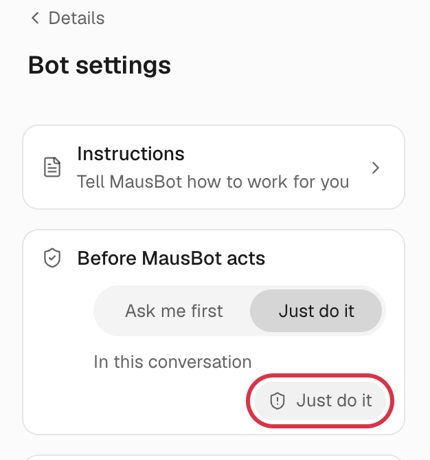
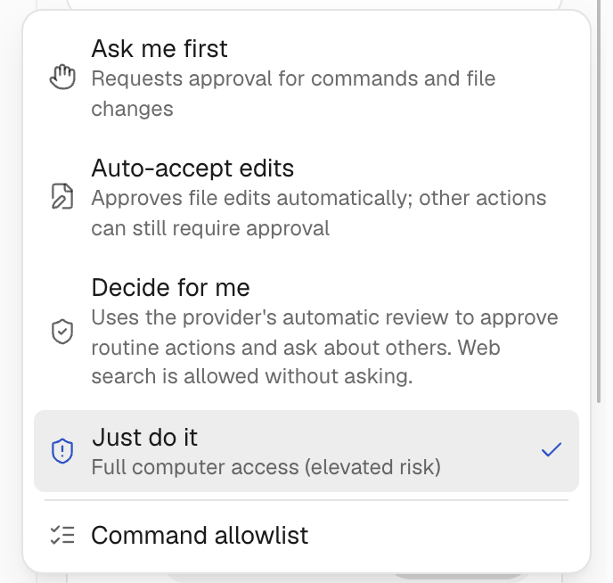
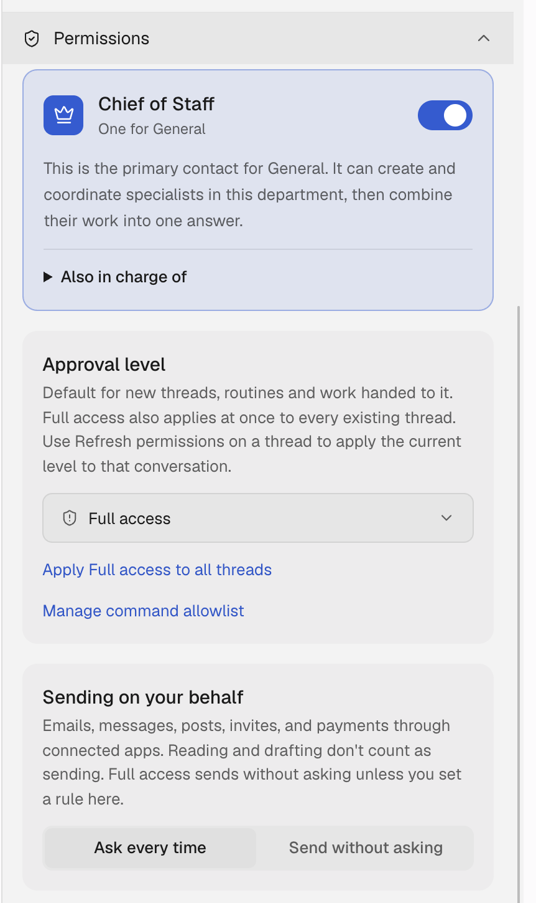

import Figure from '../../../components/Figure.astro';
import Diagram from '../../../components/Diagram.astro';


**New bots act without asking you.** They run commands, edit files and use their computer without showing you a card first. That is OpenMausBot's own default, and new conversations of a bot with no level set start the same way. The exception is a hosted company workspace, where the default is Ask me first.

This page covers what each of the four levels blocks, which one fits a given job, and how to change it. By the end you should be able to answer, for every bot on a machine: if an AI went wrong with it, how bad could it get?

<Figure name="approval-gate" alt="Four doorways of increasing width in a row: a robot stopped at a narrow slit, one held at a barrier showing a card, one passing through a turnstile, and one walking freely through a wide-open door." />

## Two interfaces, two sets of names

OpenMausBot has a simple and an advanced interface, and they name the same level differently. The first time you open the app on a device you get the simple interface; a device that used the app before an update keeps the advanced one. Switch any time under **Settings → General → Advanced mode**. It only affects the browser or desktop app you switch it in.

| Simple | Advanced | In a team file | What it asks about |
|---|---|---|---|
| **Ask me first** | **Ask for approval** | `ask` | The engine's own supervised mode: usually asks before commands and file changes (Codex is an exception, see below). The most careful level |
| **Auto-accept edits** | **Auto-accept edits** | `edits` | Edits files freely; other actions can still ask. Only Claude, Grok, Antigravity, Qwen and Gemini offer it |
| **Decide for me** | **Approve for me** | `auto` | The engine's own automatic review approves routine actions and asks about the rest, and web search doesn't ask. Codex, Claude, Cursor, Grok and Qwen support that review, though it depends on the model and account; when it isn't available, it falls back to asking, and saved grants and other exemptions still apply |
| **Just do it** | **Full access** | `full` | Asks nothing. Where new bots and new conversations start |

The table covers the engine's ordinary approval requests. A few things sit outside it: a bot reading its own files doesn't ask when the conditions below hold, a bot's changes to its own settings apply at every level, sign-ins, codes, payments and secrets always reach you, and sending through connected apps has its own check. The sections below cover each.

Antigravity is the exception: its menu says "Auto (full access)", with no automatic review, so picking it is the same as Just do it.

Codex also has a **Custom** level that reuses the approval and sandbox settings in your Codex `config.toml`. You can only pick it in the desktop app.

Details that catch people out:

- Not every engine has Auto-accept edits; OpenCode and Codex don't have that level.
- On Codex, Ask me first already writes files, inside a sandbox limited to its working folder, which is why there is no separate edits level there.
- When a bot changes its own or a teammate's profile, model, skills, team setup or team memory, the change applies at once at **every level**. No card appears; where undoing makes sense, you get a notice with an Undo button. Deleting a teammate works the same way. The one exception is a MausBot Cloud conversation a guest or a webhook started: changes there wait for the owner.

## What Just do it does not bypass

- OS privacy controls, sign-in, CAPTCHAs and multi-factor authentication.
- A provider's own account and permissions, or workspace and team ownership.
- Grants that share a computer with another bot. It only decides whether a card appears. It won't sign in for you or grant you access.
- Sign-ins, codes, payments, secrets and your own accounts still reach you. Other questions, in work another bot handed out, may be answered by that bot instead. Just do it does not make a bot self-sufficient.

**Sending** through connected apps (email, messages, invites, payments) has its own check, the bot's **Sending on your behalf** setting. **Ask every time** asks before each send. **Send without asking** sends straight away. With no setting, the approval level decides: Just do it sends, every other level asks you separately. The setting is under **Permissions** in the advanced interface. Reading and drafting don't count as sending.

## Some things no level asks about

A bot reading **its own** files usually needs no approval when the conditions below hold: its instructions (the `SOUL.md` file), its skills and every saved revision, its memory and its conversation folders. That covers commands made of plain words only, with supported flags and forms, using a read-only command such as `cat`, `head`, `tail`, `grep`, `rg`, `sed -n`, `ls`, `wc`, `nl` or `stat`, and Claude's Read, Grep, Glob, LS and NotebookRead, as long as every path is inside the bot's own folders once links are followed.

Add a pipe, a redirect, a second command, a variable or a glob and the command is handled by the level as usual. A guest's turn doesn't get this exemption and runs at Ask me first, because that folder holds the owner's memory.

On your own computer or server, every bot's commands run as the system account that runs OpenMausBot. At Just do it, a bot can read every file that account can read, SSH keys included. So rather than relying on the approval level, run bots under a dedicated account: if that account can't read your personal files, neither can the commands bots run on that server. A bot allowed to operate another computer, or connected to apps, can still reach data there; check those separately.

## Which level for which job

| What the bot does | Use |
|---|---|
| Runs routines, fires on webhooks, nobody watching | **Just do it (Full access)**, as long as it can't reach production, personal files or credentials; if it can, see the next row. Routine and webhook turns run at the bot's level too, so with Ask me first it stops at any action that needs approval and waits on a card no one will answer, or stops when the engine's own wait times out |
| Touches production: deploys, databases, live config | At least **Ask me first (Ask for approval)**, or give it an account that can only read |
| Everyday chat, writing, research | Just do it is fine; Ask me first is steadier at the cost of more taps |
| Installed on your own Mac | Be strict. It runs as your account and can read your personal files |

**Unattended work and "ask me first" contradict each other.** A routine that stops halfway to wait for a person is worse than one that never ran. So the answer is not to set everything to the most careful level: **separate what can touch production from what cannot**, and be strict only about the former.

<Diagram name="approval-flow" alt="Decision flow: if the bot can't reach production, personal files or credentials, use Just do it. If it does, use Ask me first when someone is there to answer cards, or a read-only account when nobody is." />

"Sensitive" in the chart means production, and also the personal files, accounts and credentials the bot can reach.

## How to change it

### Simple interface

**Change a bot's default:**

1. Open a chat with the bot and click the bot's name at the top center. Its profile opens on the right.
2. Click the gear icon at the top right of the profile to open **Bot settings**.
3. On the **Before \{bot\} acts** card, click **Ask me first** or **Just do it**. When you switch to the other level, every conversation the bot already has changes too.



Only those two can be clicked here. A bot that is on Auto-accept edits or Decide for me shows a third, grayed-out segment with its current level.

**Change only this conversation:** the circled button, to the right of **In this conversation**, shows the level the current conversation uses. Click it for a menu; which levels it offers depends on the engine and where it runs. Your pick applies to this conversation only:



### Advanced interface

1. In the sidebar, click **…** next to the bot and choose **Edit Profile**.
2. Expand **Permissions** and pick under **Approval level**.



Here you set the default for **new** threads, routines and work handed to the bot. Full access also applies at once to every existing thread. Any other level leaves existing threads where they are. To change one conversation, use the approval button next to its message box.

### Many at once

- **A whole department**: **Set for all bots in this department…** in the department's sidebar menu lists what each bot will get, then saves them one by one, every conversation of each changed bot included. A bot whose engine doesn't offer that level is skipped, and the summary says why.
- **Many bots**: one `approval:` line per bot in a [team file](/guides/team-file/).

:::caution[A Chief of Staff carries its level down]
Work a Chief hands out with `coordinate_bots` carries the level of the Chief's conversation, down every hop. But it only ever raises: a teammate already on a higher level, or on Custom, keeps it; when the level passed down is Auto-accept edits and the teammate's engine lacks it, the teammate keeps its own level; a Chief working at Ask me first passes nothing on; a consultation, where the teammate only answers and acts on nothing, carries no level; nor does work started by an outside event. Setting the Chief to Just do it therefore loosens the bots working for it; to tighten things, lower both the Chief and each bot's own level. Work handed between ordinary bots runs at the receiving bot's own level.
:::

**Changing a level while the bot works also applies**, depending on the engine:
- API engines (OpenAI-compatible, Grok API, Mistral and others): from the next tool call, up or down.
- Engines with their own permission modes (Codex, Claude, Cursor, Antigravity, Qwen Code, Gemini CLI and others): raising to Just do it applies from the next request. Lowering, or moving between the other three, usually applies from the next turn.
- Agents whose requests OpenMausBot answers (OpenCode, Kimi and others): from the next request.

A card already on screen is still yours to answer, and an action already running finishes. The exception is the emergency path that drops a bot from Just do it back to Ask me first for every conversation: it revokes the level at once and stops the turn the bot is running.

## What the cards offer

Cards for commands, file changes and tools have **Allow once** and **Deny**. Depending on the request, they add at most one **Always allow** button. The label is always the same; hover over it to see how far it reaches. There are three kinds:

- On a read-type tool from a custom MCP server you configured: this bot, on the same engine instance, won't ask about that tool again until the server's command, URL, headers or credentials change. Write tools, computer control and a guest's turn never get this option.
- On a command (the hint says "Always allow this command"): this bot won't ask again for the exact same command on the same engine in the same folder.
- Where the engine supports it (the hint says "Always allow this session"): the engine stops asking about this action until the session ends. API engines have no session of their own, so the allow covers only that bot, that tool and that server for the rest of the conversation, is kept in memory, and ends when the server restarts.

**Deny** stops it, and the bot sees the refusal. Every decision goes into the decision log, including the ones a routine, a webhook or another bot raised when nobody was at the keyboard.

## If you want Just do it everywhere

Do at least two things: **run bots as a dedicated user**, and **keep production credentials off that machine**. Those two matter more than the level itself.

## Let AI audit it

```text title="Prompt"
Read the approval level of every bot on my OpenMausBot server (ssh alias "myserver"):
`openmausbot team export --out /tmp/team.yaml` and look at each bot's approval field.
Then check what the system account running OpenMausBot can read (working folders, home folder, ~/.ssh, cloud config) for deploy scripts, cloud credentials, SSH private keys and database URLs; mark anything you can't check as unknown.

Give me a table: bot, approval level, working folder, the sensitive things it can reach, and the level you recommend
(keep full / switch to ask / move to a read-only account), ordered by risk. The export writes the team file and its skill files to /tmp, which is fine; don't change any bot or setting. Show me only.
```
