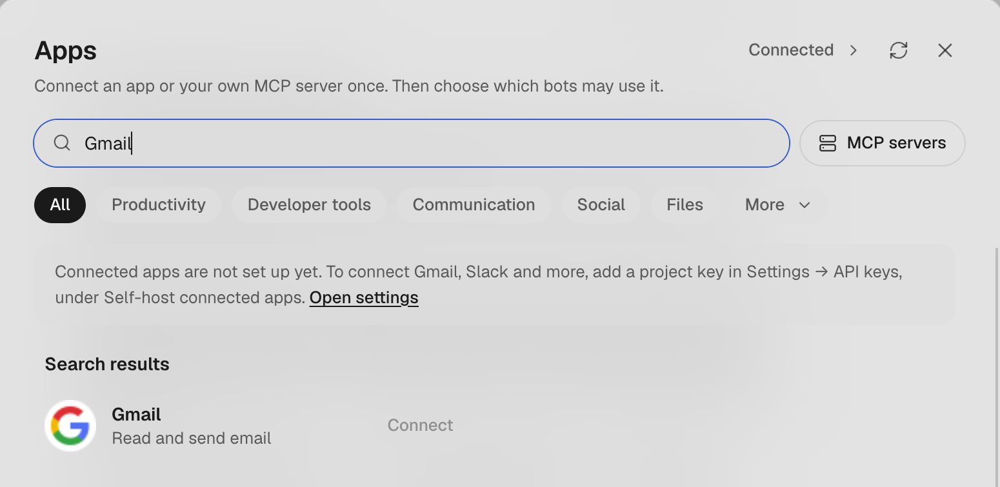
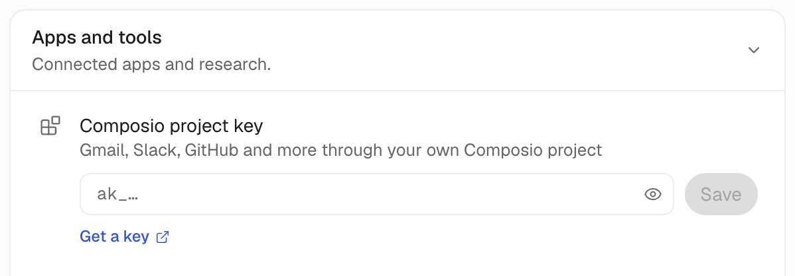

import Figure from '../../../components/Figure.astro';
import Diagram from '../../../components/Diagram.astro';

Once Gmail is connected, a bot can check your inbox, search your mail and write drafts. OpenMausBot has this connection built in, so most people don't need a Google Cloud project or their own MCP server.

<Figure name="connect-gmail" alt="Ink-wash drawing: a hand passes one small brass key to a small robot beside a wooden post box and a tied stack of blank envelopes, while a large ring of keys hangs on a high hook." />

## Before you start

- A working OpenMausBot, on desktop or a server, with at least one bot (see the [quickstart](/start/)).
- Access to the Gmail account you want to connect. You have to do the Google sign-in yourself.
- On a self-hosted server, a Composio account as well.

Replace anything in `<…>` in the prompts with your own value.

## Decisions

First, where does your OpenMausBot run? If you use the desktop app to reach a server, count it as a server.

| Your OpenMausBot | Who provides the connection | Composio key needed? |
|---|---|---|
| Desktop installer | OpenMausBot's managed service | No |
| MausBot Cloud | Included in the plan | No |
| Self-hosted server | Your own Composio project | Yes, the free plan needs no card |

Only a self-hosted server uses a Composio quota of its own. The free plan has 10,000 tool calls a month and stops at that limit ([pricing](https://composio.dev/pricing), November 2026).

There are three ways to connect. Start with the built-in one.

| Method | The catch | When to use it |
|---|---|---|
| Built-in connection | Composio holds the Google authorization | The default. One sign-in and it works |
| App password | Needs 2-Step Verification. You can't choose a scope when you create it, and [Google describes it](https://support.google.com/accounts/answer/185833) as giving an app access to your Google Account | You don't want a third party and you accept that access |
| Your own Google OAuth or Gmail MCP | Needs a Google Cloud project. While the app is in Testing, [authorization expires after 7 days](https://developers.google.com/identity/protocols/oauth2), so you sign in again every week | You want to run the whole connection yourself |

<Diagram name="connect-gmail" alt="The connection flow: desktop and MausBot Cloud go straight to the Apps window; a self-hosted server first gets an ak_ project key from Composio and saves it in Settings; then everyone clicks Connect, signs in to Google, and sets tool access for each bot." />

## Hand this to your agent

Send this to any bot in OpenMausBot. It can post a connection card for you to click.

```text title="Prompt"
Connect Gmail to this OpenMausBot, using the account label <personal>.

First check whether the connected apps service is ready:
- If it is ready, post the Gmail connection card in this chat.
- If it is not set up, tell me to get a project key starting with ak_ from Composio, then send a secure input card for it. Don't ask me to paste the key into chat.

I have to do the Google sign-in and authorization myself. Stop at that point and tell me what to click.
Don't build a Gmail MCP server, don't ask me to create a Google Cloud project, and don't switch to an app password unless I explicitly ask.

Once connected, read only the sender and subject of the three latest emails to prove it works. Don't send mail, change labels or delete anything.
Never print secrets in this chat. Back up before changing config. Ask me before changing DNS, routing or the time zone.

End with a table: connection status, account label, and which Gmail tools this bot can use now.
```

## Only you can do this

### On a self-hosted server: get a Composio project key

Skip this part on desktop and MausBot Cloud.

Until you add the key, the **Connect apps** window shows a notice at the top and every **Connect** button is gray:



1. Open the [Composio dashboard](https://dashboard.composio.dev), switch to `Platform`, select or create a project, and go to `Settings → API Keys`.
2. Create a key and copy the string starting with `ak_`. The default permissions work. For least privilege you only need Sessions read and write, Toolkits read, and Connected accounts read and write.
3. Back in OpenMausBot, open **Settings → AI**, expand **API keys**, and find **Composio project key** under **Apps and tools**. Paste the key there. It saves and checks itself.

   

   The notice in the window says "Self-host connected apps", but the group in settings is called **Apps and tools**.

### Connect the account

1. At the bottom left of the app, click **Connect apps**. Once you have an app connected, or in the advanced interface, this button is called **Apps**. In the window that opens, search for Gmail and click **Connect**.
2. Give the account a label such as `work` or `personal`. Every account needs one, and it's how you tell two mailboxes apart later.
3. Sign in to Google on the page that opens. Tick Gmail and the permission to see your email address. Contacts, birthday and phone number have nothing to do with mail.
4. Back in the app, click **Connected** at the top right of the window. The account is listed there.

One app can hold up to 5 accounts. Use **Add account** for another. **Disconnect** revokes only the account on that row.

### Limit what each bot can do

Google's consent page says the app can read, compose, send and permanently delete your mail. You can't narrow that on Google's side, so limit it per bot in OpenMausBot.

- **Simple interface**: open the bot's **Bot settings → Apps it can use** and turn Gmail on. Apps left off are out of this bot's reach. It is only on or off: once on, the bot can use every Gmail tool (read and write). To give it only some, use the advanced interface.
- **Advanced interface**: in the sidebar, click **…** next to the bot → **Edit Profile**, expand **Access**, and under **Connected apps** set Gmail to **Off**, **Read** or **Read & write**. Then expand Gmail and tick tool classes under **Per-app tools**.

Tick by what the bot does:

| What this bot does | Suggested tools |
|---|---|
| Reads and summarizes your mail | **Read** |
| Writes replies that you send | **Read**, **Draft** |
| Can send mail for you | **Read**, **Draft**, **Send**, after some thought |

Leave **Modify** and **Delete** off unless you have a clear need.

## Check it worked

Tell a bot that has access:

```text title="Prompt"
Look at my three latest unread emails and tell me only the sender and subject.
```

If it lists real emails, the connection and the permissions both work. Google usually sends a security alert about the new authorization at this point. That's expected.

## Where it goes wrong

- **The Connect button is gray and says connected apps are not set up on the host.** The self-hosted server has no project key yet. Add one using the steps above and the button becomes clickable.
- **You copied the wrong key from Composio.** A key starting with `ck_` is a consumer key for MCP clients. OpenMausBot wants a project key starting with `ak_`. Switch the dashboard to `Platform` and open API Keys in the project settings. You can ignore `Add Custom MCP`.
- **An app password keeps getting rejected.** An app password is 16 digits. If your copy has spaces in it, remove them when you paste, and check you didn't enter your Google login password. Accounts with Advanced Protection may not offer app passwords at all.
- **The bot says its model can't use connected apps.** Settings shows "The model (bot name) runs on can't use apps." (the advanced interface says **This bot's current model cannot use connected apps**). Switch it to another model.
- **Creating a filter or setting up forwarding gets refused.** The error is `403 ACCESS_TOKEN_SCOPE_INSUFFICIENT`. The default connection doesn't ask for those permissions, and reconnecting won't help. Add them with your own OAuth app under `Auth Configs` in Composio, then reconnect the account.
- **You want a bot to run on each new email, but the server can't do it.** A server using its own Composio project key can't watch app events yet. Use a routine that checks the mailbox on a schedule instead. See [how to set up routines](/guides/routines/).
