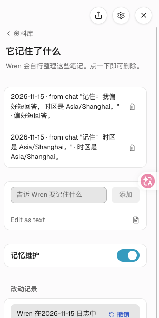

import { Steps } from '@astrojs/starlight/components';
import Figure from '../../../components/Figure.astro';

If you tell the bot your time zone again every morning, do not guess whether it remembered. Open the file that holds its memory and look.

Bot memory is plain Markdown on the machine that runs OpenMausBot. You can open it, edit it, and delete a line. This page saves a preference, checks where it landed, then removes it.

<Figure name="memory-linocut" alt="Linocut print: a robot writes a short line in a ruled notebook with small date marks, and a second robot erases one line with an eraser." />

## Decide first

| What it is | Where it belongs | Why |
|---|---|---|
| A lasting preference or fact ("short answers", "Asia/Shanghai") | Bot memory | It loads in that bot's turns, unless memory is off, the note has expired, or it is past the budget |
| A fact every bot should know about you | **About me** in Settings | Every bot reads it |
| A procedure with steps | A skill | Its index goes in while it is on, within the 30-skill and 4,000-byte cap; the body is read on demand |
| Who the bot is and what it may do | Its standing instructions | It is set on the bot itself, not per task |

Memory is for what stays true. When the bot extracts facts about you automatically, a task, a one-off question or a "suppose…" does not count as one.

## Hand it to an AI agent

Say it in the chat, in your own words. The panel shows what it saved.

```text title="Prompt for the bot"
Remember two things: I prefer short answers, and my time zone is Asia/Shanghai.

Then tell me which lines you wrote.
```

Later, to remove one:

```text title="Prompt for the bot"
Forget Asia/Shanghai.
```

Forget looks at the words in the note, not at the chat it came from. It first normalises case, width and quote style, then matches your phrase as one whole passage: both ends must be word boundaries, and it needs at least three letters or digits. So "IST" does not match "dentist". Matching memory entries go, including the bot's own memory; headings, frontmatter and some other parts are left alone, and a Chinese phrase pressed against other Chinese characters may not match. Check what is left after the delete. If you asked in a one-on-one chat of your own, the matching note in **About me** goes too.

## Do it yourself

<Steps>

1. Open the bot's profile, then **Library → What it remembers**. The panel lists notes the bot kept, not only the raw `MEMORY.md`; notes that can be deleted show a delete button on the right. What a turn actually loads is `MEMORY.md` after expired entries are removed, up to the first 200 lines or 24 KB.

2. **Edit as text** opens the raw file. A save is refused if the bot changed it while you were typing, and your draft stays on screen so nothing is lost.

3. The change log under the panel lists edits with **Undo**, including the ones the bot made during a turn. Some rows cannot be undone and say so: for example one whose earlier text held a credential, or one too large to keep.

</Steps>



There are two limits to watch. Each turn loads `MEMORY.md` after expired entries are removed, then takes the first **200 lines or 24 KB**, whichever comes first; nothing past that loads. When a bot write fills the file, older entries can move to `memory/archive.md`, which is still searchable: struck-through entries first, then expired ones, then the oldest live dated entries. The entry just written and some core facts that are not struck through and not expired do not move, and if there is not enough room, none may move. A line you wrote by hand without a date stays.

## Only you can do this

<Steps>

1. Decide what is durable. A time zone, a diet, a client's name and a preferred format are durable. "Write a launch plan" is a task.

2. Read the entries now and then. A wrong fact in memory can shape later answers until someone deletes it.

3. Keep secrets out. A write made through the app redacts things that look like keys and passwords, but a bot with file access can edit the file directly. Memory is not a vault, and it is not a place for a token you need later.

</Steps>

## Check it worked

1. In this run, the panel showed one dated line per fact, with the chat it came from. A line you write by hand does not always appear as a note; the raw file is the record.
2. On disk, with the default data folder, `MEMORY.md` is at `~/.openmausbot/workspaces/<bot id>/MEMORY.md`; topic files sit in the `memory/` folder beside it.
3. Ask "what do you remember about me?" in a new conversation. Treat the answer as a hint and the panel or file as the evidence.

## Where it goes wrong

**The bot says it remembered, but the file is empty.** Check the panel, not the reply. A bot can confirm in words without a successful write.

**A fact loads in one bot and not another.** Memory belongs to a bot. A fact for every bot goes in **About me**.

**The file grew past 200 lines.** Each turn removes expired entries, then loads the first 200 lines or 24 KB, whichever comes first. Move detail into topic files, or tidy the file when the bot offers to.

**A deleted fact comes back.** Deleting a line in the panel and asking the bot to forget it are different actions. A panel delete handles that row; to clear the words, ask the bot to forget them in a one-on-one chat. Saving that content again later clears the forget state, so check what is left afterwards.

**Turning memory off.** In the bot's settings, in the memory section, turn off **Let this bot use memory** while the bot is idle. `MEMORY.md` stops loading and recall stops. The files stay on disk, and a bot with file access can still edit them directly. The **Memory upkeep** switch in the screenshot is a different setting.

## Next steps

- [Turn a repeated job into a skill](/guides/skills/): procedures are not memories.
- [Three bots, one job](/recipes/three-bot-team/): each bot keeps its own memory.
- [Approval levels](/concepts/approval-levels/): what still asks for a card.
