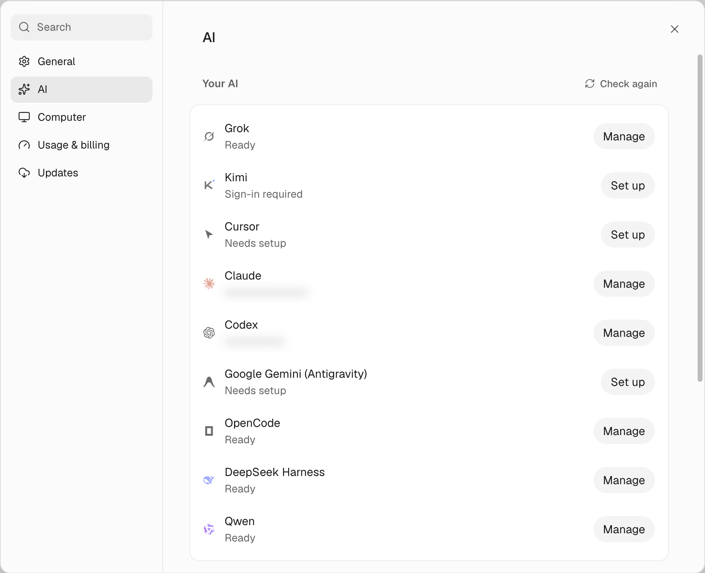

import Figure from '../../../components/Figure.astro';
import Diagram from '../../../components/Diagram.astro';

An engine is the agent CLI a bot runs on: `claude`, `codex`, `opencode`, and so on. On a server, each engine needs
its own sign-in **on the server**, because that's where the processes run. You can install a CLI from
**Settings → AI** (it goes into `~/.openmausbot/tools`) or with npm yourself. Either way, sign it in on the server.

<Figure name="sign-in-engines" alt="Layered paper-cut art: a robot carries a large key from a glowing phone toward a screenless server with a slot, with five differently shaped keys hanging from its belt." />

## Before you start

- An OpenMausBot server you can reach with `ssh myserver` from this computer (see [how to run OpenMausBot 24/7 on a home server](/guides/home-server/)).
- The subscription or API key for each engine you want.

Below, `myserver` is the server's SSH alias and anything in `<…>` is a value you replace.

## Decisions: which engine first

Ranked by how well sign-in works on a machine without a screen:

| Engine | How it signs in | Headless | You need |
|---|---|---|---|
| **OpenCode** | API key (copy it from the opencode.ai console, paste it with `opencode auth login` on the server) | ★★★ | OpenCode Go/Zen, or nothing (free models) |
| **Codex** | Device code (enter a code on a web page) | ★★★ | ChatGPT subscription |
| **Kimi** | Device code | ★★★ | Kimi Code membership |
| **DeepSeek Harness** | API key | ★★★ | DeepSeek API key (pay as you go) |
| **Claude Code** | Open the sign-in page, paste back the code it shows | ★★ | A paid Claude plan such as Pro or Max |
| **Antigravity (Gemini)** | Sign in to Google in a browser, paste back the address of the page it redirects to | ★ | A Google account |

Get one easy engine working first (OpenCode or Codex), prove the whole chain with a real
message, then add the fussy ones.

OpenCode also has free anonymous models. They are good for testing the pipeline, not for real work.

<Diagram name="signin-spectrum" alt="Four sign-in methods from easiest to fussiest on a server: device code (Codex, Kimi), API key (OpenCode, DeepSeek), open a link and paste a code (Claude Code), browser sign-in and paste the callback URL (Antigravity)." />

## Hand this to your agent

```text title="Prompt"
On my OpenMausBot server (ssh alias "myserver"), get engines signed in. I want: <engines, e.g. OpenCode Go and Codex>.

- OpenCode needs an API key: let me `ssh myserver` and run `opencode auth login` myself, choose OpenCode Go and paste the key. Don't handle the key.
- For device-code engines, start the sign-in on the server and give me only the URL and code to enter.
- After each engine: run `openmausbot models` on the server and confirm its models are listed. Then run
  `openmausbot run "MausBot" "Reply with exactly: OK"` on a model from that engine.
- Set the default model for new bots to <model> if I named one.

Never echo API keys, tokens, or auth files. If a sign-in needs a browser step, stop and tell me exactly what to click.
```

## Only you can do this

- **Approve each sign-in in your browser:** enter the device code (Codex, Kimi), or open the sign-in page and paste back
  the code it shows (Claude). Use the account that has the subscription. You can also do these from **Settings → AI**: click **Set up** on the engine and finish in your browser, no terminal needed.
- Paste API keys into **Settings → AI → API keys** yourself, not into a chat with your agent. OpenMausBot stores them
  write-only and passes them only to the engine process.

## Check it worked

Open **Settings → AI**. Each signed-in engine is listed under **Your AI** with its account email or **Ready**. Then open the model selector at the top of any chat and check that its models are listed.



## Where it goes wrong

- **Two providers, almost the same model names.** In OpenCode, `Go · DeepSeek V4.1 Flash 1017` is your Go subscription.
  `Zen · DeepSeek V4.1 Flash 1017` bills your Zen balance by usage. Pick by the prefix, not the name.
- **Claude sign-in fails.** In **Settings → AI**, click **Set up** on Claude again, open the complete sign-in page, check the
  browser is signed into the Claude account you mean, and paste back the whole code it shows.
- **Antigravity doesn't reuse your existing agy login.** OpenMausBot installs its own Antigravity runtime, separate from
  the Antigravity app and the `agy` CLI. Install it from **Settings → AI** and sign in with Google there. Each setup has its own Google account.
