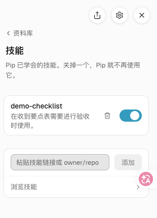

import { Steps } from '@astrojs/starlight/components';
import Figure from '../../../components/Figure.astro';

You have explained the same checklist three times this week. A skill is how you stop explaining it: instructions in a file the bot reads when the task fits. This example uses one short file. For a skill the bot wrote itself or took from the library, its name, description and path go into the bot's turn while it is on, unless the cap leaves it out. The index tells the bot to read the body before a task it covers.

This page turns "check a handover file" into a skill, then checks the next task against it. The whole thing is one file, plus a switch, or an approval if the bot's permission level asks for one.

<Figure name="skill-blueprint" alt="Blueprint drawing: one robot folds a long strip of paper into a card with three creases, and a second robot unfolds the same card and points at it." />

## Decide first

| What you want to keep | Where it goes | Why |
|---|---|---|
| A procedure with steps and a finish line | A skill | The index goes in while it is on; the body is read on demand |
| A fact or a preference ("short answers", "Asia/Shanghai") | Memory | It is available to that bot within its memory budget, when memory is on |
| A rule for who the bot is and what it may do | Its standing instructions | It is set on the bot itself, not per task |
| Work that should happen at a time | A routine | A skill says how, a routine says when |

If the procedure changes every time, do not make a skill yet. Write it down after the third time it looks the same.

## Hand it to an AI agent

Send this to a bot that supports skill writing, with skill authoring on. Ask it to write the file and tell you where it put it.

```text title="Prompt for the bot"
Turn this procedure into a skill called demo-checklist:

1. The file exists.
2. Its length is within the range I asked for.
3. Its last line names where the facts came from.

Write the description as one line that says when to use it, for example "Use when a handover table needs a check."
Keep the body under 20 lines.
Then tell me the skill name and the full path of its SKILL.md.
```

The name must be 1 to 64 characters: lowercase letters, digits and single hyphens. The description is what helps the bot decide whether to read the body, so write it as a moment, not as a topic.

Do not ask for a skill yet if the procedure needs permissions to run. A skill can say *how* to do something. It cannot give the bot access it does not already have.

## Do it yourself

<Steps>

1. This page uses the simple interface. Open the bot's profile and choose **Library → Skills**.

2. If you are importing an existing skill: paste a GitHub repository, a `SKILL.md` link on GitHub, a skills.sh link, or owner/repo, then choose **Add**. A skill imported from a link or repo arrives switched off, so read it before you turn it on. In advanced mode, open the bot's own settings and choose **Skills**: if the skills library is on, add from the library list; if it is off, paste the link and choose **Import**.

3. To write one yourself, use the shape below, send it to the bot, and ask it to save the text as a skill. Then check it in the panel. If the bot applied a new skill, the switch is already on. If it updated one, or the change is waiting for review, check the switch there.

</Steps>

```text title="SKILL.md"
---
name: demo-checklist
description: Use when a handover table needs a check.
---

# Handover check

1. Confirm the file exists at the path in the message.
2. Count the words and compare with the requested range.
3. Read the last line. It must name the source of the facts.
4. Reply with one line: passed, or the first check that failed.
```



With the default data folder, a skill the bot writes itself can sit under `~/.openmausbot/workspaces/<bot id>/skills/<name>/SKILL.md`, or in a revision folder beside it. A skill from the library is read from the library. The path in the index is the one that counts.

## Only you can do this

<Steps>

1. Decide the trigger. A description like "for reviews" is too vague. "Use when a handover table needs a check" is a moment the bot can match.

2. Read the text before switching it on. A skill is instructions. The review scanner warns about a download piped into a shell, a long encoded blob and invisible characters; those are warnings, not a block.

3. Decide who gets it. A skill the bot learns belongs to that bot until you share it. Sharing moves it to the library and assigns it to eligible bots on the team. A conversation that was already running can get a note with the skill's path; a new conversation can pick it up in its index, within the same limits as any skill. A bot that already has a skill with that name keeps its own.

</Steps>

## Check it worked

1. The bot's **Library → Skills** lists the skill with a switch that is on.
2. Ask for the next matching task and watch whether it follows the checks you wrote. In the demo run the answer followed the three checks in order; the wording is the model's, not a fixed template.
3. Ask the bot to do something unrelated. If its answer mentions the checklist, check whether the description is too broad.

## Where it goes wrong

**The bot never uses it.** The description is a topic, not a trigger, or the switch is off. Rewrite the description as "Use when …" and try a task that matches it word for word.

**The bot reads the wrong copy.** The path it reports is not the one you meant. Ask the bot for the path it read. The panel shows names, not paths; if the bot's own skill and a library skill share a name, the bot's own one wins. Open the skill it read and check that copy.

**An imported skill does nothing.** Skills imported from a link or repo start switched off. Turn it on in the bot's skills panel, or in the library if you assigned it there.

**The skill list is trimmed.** The index for the bot’s own and library skills holds at most 30 skills and about 4,000 bytes. Past that the bot is told some were left out. Turn off the ones this bot does not need.

**The skill promised something it cannot do.** Skills are instructions, not permissions. If the procedure needs a folder, an app or a computer, set that on the bot itself.

## Next steps

- [Three bots, one job](/recipes/three-bot-team/): where a handover skill fits in a relay.
- [How to make a bot work on a schedule](/guides/routines/): turn the same procedure into a daily job.
- [Approval levels](/concepts/approval-levels/): what a skill still cannot do without a card.
