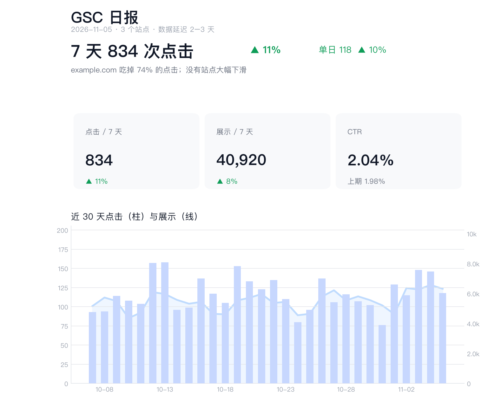

import { Card, CardGrid, LinkCard, LinkButton, Steps } from '@astrojs/starlight/components';
import Figure from '../../components/Figure.astro';

Put a team of AI bots to work around the clock. Unofficial OpenMausBot guides where every use case comes from a bot we really run, and every step can be handed to your AI agent.

<LinkButton href="/start/" icon="right-arrow">Get started in 15 minutes</LinkButton>
<LinkButton href="/recipes/" variant="secondary">See what it can do</LinkButton>

<Figure name="hero-room" alt="A cut-away isometric room: a small computer with a green status light sits on a shelf, three small white robots read a report, fix a cable and hold up a chart, and a hand outside the room holds a phone showing three progress dots." />

## Four things people love first

<CardGrid>
	<Card title="Every subscription in one place" icon="puzzle">
		Claude, Codex, Gemini (Antigravity), OpenCode Go… no more switching between CLIs. Give each bot a model and run them all from one chat app.
	</Card>
	<Card title="Watch your bots work from your phone" icon="phone">
		The server runs at home. On the train you open your phone, see what every bot is doing, and approve a card with one tap.
	</Card>
	<Card title="Work that happens on schedule" icon="clock">
		Routines wake bots up on time, and can be set to ping you only when there is a result, like the report below that lands in a group chat every morning. See [routines](/guides/routines/).
	</Card>
	<Card title="A team that helps itself" icon="comment-alt">
		One bot per job, each with its own model, memory and tools. They can hand problems to each other instead of back to you.
	</Card>
</CardGrid>

## Every morning at 9, a report like this lands in our team chat

One of our bots merges Search Console data for multiple sites across several Google accounts into a daily report and posts it to a Feishu group. The bot built the code, database and schedule itself; we did a few settings in Google Cloud, consented once per Google account and added a bot to the Feishu group. The image above is the bot's report rendered with demo data; the group receives a Feishu card with the same structure, its charts drawn by the card's own chart components.

<LinkCard title="Use case: a daily Search Console report built by a bot" href="/recipes/gsc-daily-report/" />

## More real use cases

<CardGrid>
	<LinkCard title="Claude, Codex and Gemini in one chat" description="Give each bot the subscription that fits: cheap models for daily work, strong ones for heavy lifting." href="/recipes/all-subscriptions/" />
	<LinkCard title="Watch and approve from your phone" description="The server works at home; you check progress, approve cards and press Stop from anywhere." href="/recipes/phone-remote-control/" />
	<LinkCard title="Split the work across bots" description="Fast chat, hands-on operator, scheduled checks: give each bot only the tools it needs." href="/guides/team-file/" />
	<LinkCard title="Track the hottest posts on X" description="The top posts on a topic, with links, every week, and silence when nothing changed." href="/recipes/x-trend-digest/" />
</CardGrid>

## Recommended path

<Steps>

1. **[Get started in 15 minutes](/start/)** on your Mac, using the Claude or Codex login you already have.

2. **[Run a use case](/recipes/)**: real use cases click faster than feature lists.

3. **[Move to an always-on server](/guides/home-server/)**: routines need a machine that never sleeps. A low-power mini PC is plenty.

4. **[Fix problems fast](/reference/troubleshooting/)**: common problems, their error messages and the fixes.

</Steps>

## Find your way

<CardGrid>
	<Card title="New to OpenMausBot" icon="information">
		Read [how it works](/start/overview/), then decide [where your bots should run](/concepts/where-to-run/).
	</Card>
	<Card title="A task takes forever" icon="warning">
		Usually it is just many steps: dozens of model calls and tool runs. See [why one task can take an hour](/concepts/long-tasks/).
	</Card>
	<Card title="Prefer the command line" icon="seti:shell">
		The [CLI reference](/reference/cli/): set up a team, give a bot a job, wait for it and check status from the command line.
	</Card>
	<Card title="Let AI do the setup" icon="rocket">
		Most how-to guides include a prompt you can paste into Claude Code, Codex or OpenCode.
	</Card>
</CardGrid>
