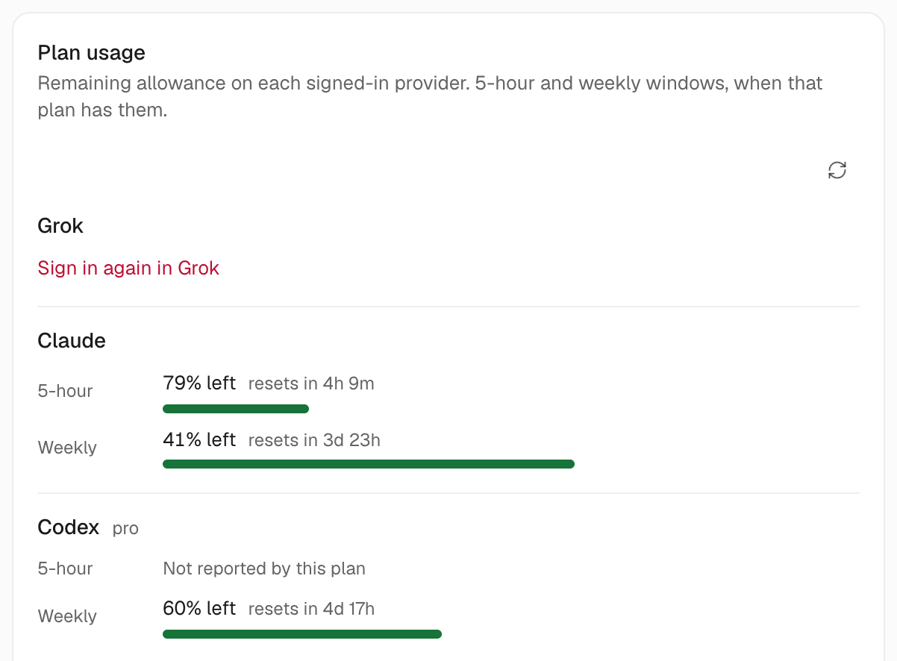

import Figure from '../../../components/Figure.astro';

If you pay for Claude, ChatGPT (Codex) and OpenCode Go and also use Gemini (Antigravity) like we do, you probably jump between CLIs all day. None of the quotas get used up, and it's hard to say which job belongs where.

With OpenMausBot, each subscription becomes one or more bots, and you direct them from one chat app. It drives the CLIs already signed in on your computer or server, so you don't need new accounts and your requests don't go through a proxy.

<Figure name="subscriptions" alt="Four robots on the left, each with a differently coloured cable; the cables merge into one green line that plugs into a single chat bubble, and a finger taps the bubble." />

## How we split our bots (November 2026)

| Engine / subscription | Model | Used for | Why |
|---|---|---|---|
| OpenCode Go | DeepSeek V4.1 Flash | Most bots on the server: the Chief, the daily report and odd jobs | A subscription, fine to run all day |
| Antigravity (Gemini) | Gemini 3.8 Flash | Bots that watch videos and research | Understands video directly |
| Claude Code (separate setup on a Mac) | Claude Sonnet 5, Opus 5.5 | The Mac's Chief and two other bots | Already signed in on the Mac; works the moment the app opens |

Of the 51 bots on the server, 39 run DeepSeek and 10 run Gemini. The Mac has 5 bots: the Chief and one other run Claude Sonnet 5, one runs Opus 5.5, and two run DeepSeek on OpenCode Go.

We put daily work on cheap subscription models and save the strong ones for occasional heavy work. That way every quota gets used and no single one runs dry.

## Connect your subscriptions

- On a Mac, the `claude` and `codex` you're signed in to are detected automatically. See the [quickstart](/start/).
- On a server, sign each engine in once. Codex and Kimi use device codes, and OpenCode signs in with an API key. See [how to sign in to engines](/guides/sign-in-engines/).
- Any OpenAI-compatible API (DeepSeek's API, local LM Studio) can be added as an engine under **Settings → AI → API keys → Your own model servers**, with no code.

Once connected, open the model selector at the top of any chat to see which models this machine can use.

## Switching a bot's model

Open a chat with the bot, click the model selector at the top, pick a new model, and choose where it applies under **Apply model changes to**:

- **Only this thread**: changes this chat only. Other chats stay as they are.
- **Thread + bot default**: the bot uses the new model by default from now on.

To change a group at once, open the department menu in the sidebar, choose **Set for all bots in this department…**, and go to **Model and effort**.

If the bot runs on a server, you can also send this to your AI agent:

```text title="Prompt"
On my OpenMausBot server (ssh alias "myserver"), change the default model of "<bot name>" to <the model you want>.
Look up the exact model name with openmausbot models first; don't guess. Then tell me the old and new models.
```

:::caution[Same name, different bill]
In OpenCode, `Go · DeepSeek V4.1 Flash 1017` uses your Go subscription; `Zen · DeepSeek V4.1 Flash 1017` bills your Zen balance by usage. Check the prefix before you pick.
:::

## See where the quota goes

**Settings → Usage & billing** shows only your busiest plan at the top. Open **See all limits** and scroll to **Plan usage**: each signed-in plan gets a row with how much is left and when it resets.



A few things are easy to misread:

- Claude reports both the 5-hour and the weekly window, each with a reset countdown.
- Our Codex Pro plan reports only the weekly window, so its 5-hour row says "Not reported by this plan" even though it's signed in. OpenMausBot shows whichever windows OpenAI returns for your plan, so yours may differ.
- The same quota can appear on two rows. Ours shows "Claude" and "Claude (API key)" with identical numbers.
- **Where it went**, higher on the page, lists cost by bot, model and more, for today, the last 7 days, this month and other periods. Subscription plans show percentages left under **Plan usage**.

Give more bots to the subscription with the most headroom.

## Next steps

- [Watch and approve from your phone](/recipes/phone-remote-control/): the server works at home, and you check progress and approve cards from anywhere.
