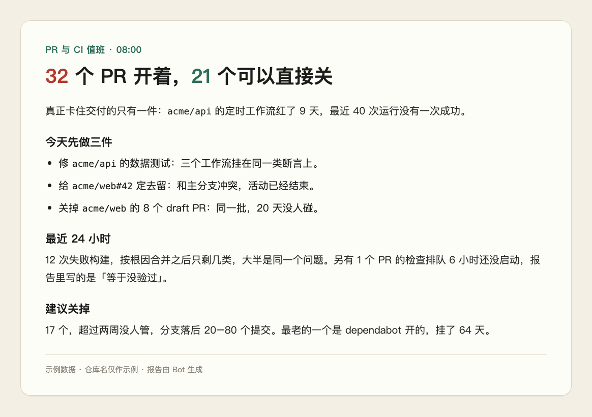

import { Steps } from '@astrojs/starlight/components';
import Figure from '../../../components/Figure.astro';

Every morning, one message arrives: how many pull requests are open, which ones can be closed, which build went red yesterday, and the three things to do first.

<Figure name="github-triage" alt="An isometric workroom: cards arrive on a conveyor, a robot sorts them into green, sand and terracotta trays, a tall stack waits beside it, a monitor glows red and the wall clock has no numerals." />

Here is a sample report with made-up data:



## What the message contains

The conclusion comes first, then the numbers and lists.

What matters is the short list that blocks delivery: a workflow that has been red for a long time, a check that has been queued for hours, a pile of pull requests nobody owns. The report separates them so you do not have to dig through dozens of rows.

## What to tell the bot

```text title="Request for the bot"
You are my GitHub duty bot. Read only.

Every morning, go through the repositories under these accounts (I will send the account names after this):
- how many pull requests are open per repository, and how old the oldest one is;
- builds and deploys that failed in the last 24 hours.

Sort pull requests into three groups, with repository and number:
1. checks green and no conflict with the main branch, list first for my review;
2. conflicts, stale branch, or checks that never finished, needs work first;
3. untouched for more than two weeks, suggest closing, with one line why.

Sort failed builds into three groups:
- the same root cause repeating, merged into one item that names the step and the error;
- failures only on old branches that the latest commit already fixed, marked as self-healed and kept out of today's list;
- apparent one-offs, listed on their own line.

Finish with exactly three things to do first today, plus the list of pull requests to close.
Conclusion first, then the numbers. Do not paste full logs.

Constraints:
- Read only. Do not merge, edit, push, comment or close anything.
- Never print tokens, cookies or any secret in the chat.
- Back up before changing any config. Ask me before changing DNS, routing or time zone.
- For anything I have to do, say which repository and where to click.
```

## Only you can do this

<Steps>

1. **Sign in to the GitHub CLI.** Let the bot install it and start the login. It hands you a URL and a one-time code; enter the code in the browser and approve. For a hard read-only limit, create a fine-grained token with read access only and give that to the bot.

2. **Say which accounts to watch.** One or several. Also say whether dependabot PRs should be included.

3. **Check the first set of numbers.** Compare the open PR count and the oldest PR against GitHub itself. If they differ, have it run again.

</Steps>

## The decisions that made it work

| Decision | Recommendation | Why |
|---|---|---|
| Permissions | **Read-only behaviour first**, then a read-only token | An instruction constrains behaviour, while a token blocks writes |
| How many repositories | All of them, grouped by repository | Watching only active repos leaves old dependabot PRs to rot |
| PR buckets | Merge, fix, close | Three buckets map to three actions, so the report tells you what to do |
| Failure reporting | Merge by root cause | Sixteen failures can have two causes, and a list of sixteen gets ignored |
| Report length | Conclusion, three items, lists | You have two minutes in the morning |

## Where it goes wrong

**The report says checks passed, but they never ran.** Queued, cancelled and skipped are not passing. Have it list unfinished checks separately and say what they are waiting on.

**The same error appears every day.** Merge it into one root cause. If it has gone unfixed for days, put it first and state what it blocks.

**The main branch is red too.** Fix main first instead of spending time on the branch.

**Dependabot PRs reach a hundred days.** Have the bot propose them in batches for closing, or turn on auto-merge for the repository.

**The report is too long.** Put "do not paste full logs" in the brief and keep the conclusion, causes and three items.

## Verify

After the first run, compare against GitHub: the number of open PRs, the oldest one, and the recent failed builds. If they differ, have it run again.

To check that it did not touch the repository, look for new commits or PR changes afterwards. That catches obvious writes but does not prove nothing else happened. The **Run logs** on the routine show the result of that run.

## Make it yours

- **One repository only:** name it in the brief, change nothing else, and the report reads in seconds.
- **Send it to a team channel:** a morning duty report belongs where the team sees it.
- **Let it fix CI after approval:** if you want that, write down which repositories it may edit and who approves the change. Leave it read-only by default.

## Next steps

- [How to make a bot work on a schedule](/guides/routines/): time zones, cron and recovery.
- [A daily site check](/recipes/site-health-check/): another job that suits the morning.
