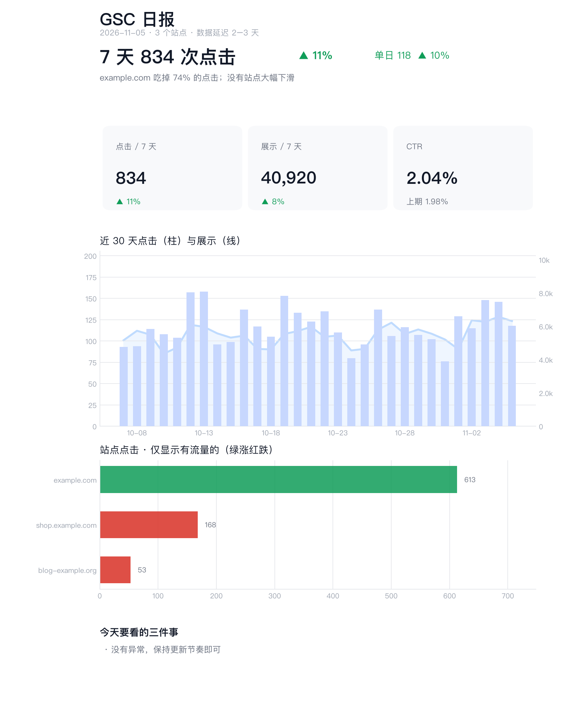

import { Steps } from '@astrojs/starlight/components';
import Figure from '../../../components/Figure.astro';
import Diagram from '../../../components/Diagram.astro';

Every morning at 9 a report appears in our team chat: a one-line verdict, three key numbers, a 30-day trend, which sites grew or dropped, and which pages get impressions but no clicks. This is the same report rendered by the bot with demo data:



We use this bot every day. It covers all the Search Console properties across several Google accounts. The bot built it in about 3 hours of conversation, and the hands-on part is just the three steps below.

## How it works

<Diagram name="gsc-pipeline" alt="A routine wakes the bot at 9:00 every day. Search Console data from several Google accounts syncs into a local SQLite database, the report is built from it and sent to a Feishu group through a custom bot webhook; if delivery fails, the bot explains why in chat." />

An OpenMausBot routine wakes the bot at `0 9 * * *` and it runs the script it wrote. The script does the heavy lifting. The model only orchestrates, handles errors and explains them. A real run: 19 steps, under 3 minutes, about 488 k input tokens, 94% of them cache hits. If a delivery fails, the bot leaves the reason in its chat instead of silently skipping a day.

## You need

- An [always-on OpenMausBot](/guides/home-server/) (routines don't run while a Mac sleeps).
- A bot on a cheap, fast model (we use DeepSeek V4.1 Flash on OpenCode Go).
- Your Google account(s) and a group chat with incoming webhooks (we use Feishu; Slack, Teams, Telegram, WeCom and DingTalk work the same way).

## What to tell the bot

No code from you. Create a bot (call it "SEO") and send it:

```text title="Request for the bot"
I have several Google accounts, each with sites in Search Console. Combine the data for all of them:

1. Authorize these accounts with OAuth (one consent each). New sites should join the report automatically.
2. Store data in a local database, sync incrementally every day, keep the history.
3. Every day at 9:00 my time, post a report to my group chat: a one-line verdict at the top, then
   7-day clicks, impressions, CTR with change, a 30-day trend, sites with traffic ranked by clicks,
   sites with impressions but no clicks listed separately, details collapsed.
4. Send it through the group's incoming webhook. Ask me for the webhook URL with a secret card,
   never in chat.
5. If it fails, tell me why in this conversation. Never skip silently.

Show me the report on demo data first; connect real data after I approve the format.
```

<Figure name="gsc-report" alt="Editorial illustration: an alarm clock launches report pages along a dashed arc, growing larger as they fly, and a robot in a scarf carries the final page with a green chart toward a chat bubble." />

## Only you can do this

<Steps>

1. **Consent once per Google account.** The bot sends a Google sign-in link. Sign in with that account, approve, and paste the redirect URL from the address bar back to it.

2. **Add an incoming webhook to the group.** In Feishu: group settings → Bots → Add bot → **Custom bot**, name it, choose **custom keyword** security with `GSC` (always in the report title), and copy the webhook URL.

3. **Paste the webhook into the bot's secret card**, not the chat. Secret cards hand the value to the bot's process without it ever appearing in the transcript.

</Steps>

## The decisions that made it work

| Decision | Our choice | Why |
|---|---|---|
| Reading several Google accounts | **OAuth per account** | The bot first proposed a service account, which has to be added to every property by hand. With OAuth, each account consents once and new sites appear automatically |
| Will the token expire in 7 days? | **Publish the OAuth app to production** in Google Cloud | Refresh tokens of apps in testing expire after 7 days and the report silently stops |
| Which chat bot type | **Incoming webhook (custom bot)** | In Feishu, a group with external members only accepts custom bots, not app bots |
| Layout | Verdict → three numbers → trend → collapsed details | The report's job is to tell you in five seconds whether today needs attention |
| Dates | Treat data as 2 days late | Search Console lags; counting "today" always undercounts |

:::caution[Feishu external groups]
External groups accept only custom (webhook) bots. App bots fail with `232033`. Inviting an external member into an internal group creates a new external group without the bot. Renaming or disbanding an external group is client-only. The API refuses.
:::

## Have the bot save what it learned

Afterwards, the bot saved the whole procedure and its pitfalls as a reusable skill. The next time you ask for "a daily push to some group", it follows that path directly. When something works, say "save how we did this as a skill".

## Make it yours

- **Another chat app:** swap the webhook for Slack, Telegram, Teams, WeCom or DingTalk.
- **One site at a time:** add a site filter and send a separate report for each site.

## Next steps

- [Track the hottest posts on X](/recipes/x-trend-digest/): the top posts on a topic every week, with links, and silence when nothing changed.
