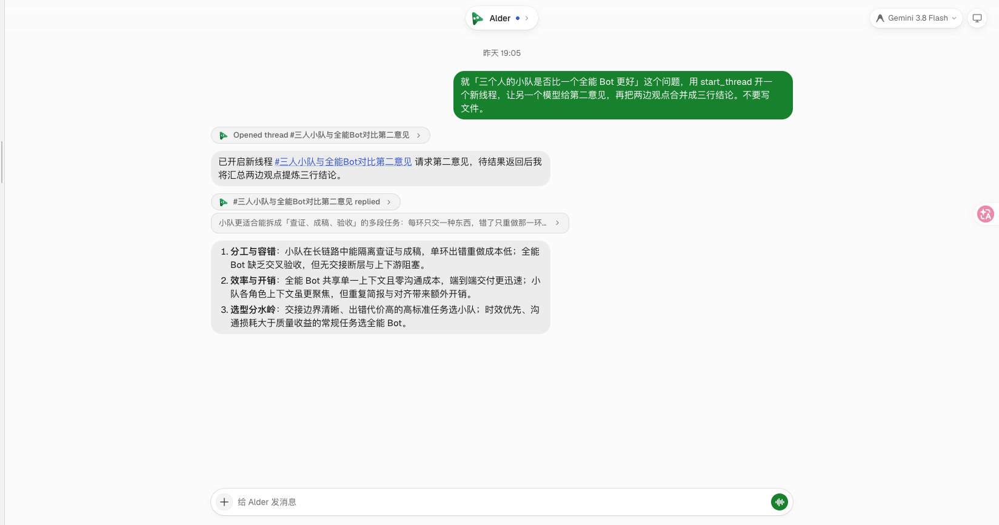

import { Steps } from '@astrojs/starlight/components';
import Figure from '../../../components/Figure.astro';

A second opinion usually means another bot, another folder and another set of instructions. A bot can do it alone: it opens a thread on a different model, a sub-conversation under the same bot, and brings the answer back to the conversation it started from.

This works because a thread is a conversation of its own, under the same bot, with its own model choice and its own turn.

<Figure name="second-opinion-riso" alt="Risograph print: one robot at a desk with a sheet of paper, two small robots on either side leaning in with different-shaped speech bubbles above its head." />

## What happens

<Steps>

1. The bot lists the models and the status the list reports. The list does not test whether a model can reply.

2. It opens a thread on another model (the one you named, or one it picked) with `report_back`, which brings the result back to the main conversation, and asks one bounded question. When threads are shown, the thread appears under the bot in the sidebar.

3. The main conversation shows **Opened thread #…** (the screenshot below shows the English status). When the thread finishes successfully and the result is allowed back, a replied line can appear with a preview of the answer under it, and the bot carries on with the result in hand.

4. The bot then tries to merge the answers. The thread keeps its own history, so you can open it and read the whole thing.

</Steps>



## What to tell the bot

Send this from a one-on-one conversation with the bot. Before you send it, make sure at least two models can reply (see step 1 under "Only you can do this"). The thread cannot see this conversation, so put the background and constraints the second model needs into the question.

```text title="Request for the bot"
On the question below, get a second opinion from another model.

1. Use list_models to pick an available model that is not the one you are running on.
2. Open a thread on it with report_back, and ask the question, bounded to what I asked.
3. When it replies, compare the two answers and give me three points:
   where they agree, where they differ, and which one you would act on.

Do not write files. Do not hand this to another bot.

Question: is a three-person team better than one general bot?
```

Name the model if you care which one answers. If you leave it to the bot, the request tells it to pick from `list_models`.

## Only you can do this

<Steps>

1. Pick a second model that already works. Send it one short task first; if that fails, fix the engine before you rely on a second opinion.

2. Decide the question. One bounded question gets a useful answer; five questions in one thread can get a summary of a summary.

3. Decide up front how to weigh a disagreement. The merge is the point, not the second answer on its own.

</Steps>

## The decisions that made it work

| Decision | Recommendation | Why |
|---|---|---|
| Which model | One from a different provider, if you have it | Same-family models may share blind spots |
| How many threads | One per question | Each thread has its own conversation and task |
| What comes back | A short answer plus the points to merge | A long answer is harder to merge, and detail can get lost |
| Who decides | You | Two confident answers can still both be wrong |

## Check it worked

1. The main conversation shows **Opened thread #…** and, when the thread finishes successfully and the result is allowed back, a reply may appear under that title.
2. The thread is a row under the bot, not under another bot, and it keeps its own model.
3. The final reply contains the merge, not a copy of the second answer.

## Where it goes wrong

**The thread ran on the same model.** Name the model explicitly in the request; after the thread opens, open it and check its model choice.

**The model is listed but will not run.** It may not be signed in, the engine may not start, or the model may not be available to your account. Check the engine settings before retrying.

**The thread is missing from the sidebar.** Threads opened this way sit under the bot. If the sidebar hides threads, switch to advanced mode, open **Settings → Appearance**, and turn on threads in **Threads**; then use the chevron beside the bot to expand its thread list.

**Nothing comes back.** Expand the bot's thread list and open the thread first; it may be stuck on an error. In this tutorial, ask from a direct conversation with the bot. A thread opened this way cannot open another thread of its own, so do not ask from inside an existing thread.

## Make it yours

- Two models on a review: do not run every change through both; ask for the second opinion only on changes you would otherwise argue about.
- A cheaper second model: the second thread runs on its own model, so you can use a small model for a cross-check if it is good enough for the question.
- Three views: one thread per model, then a merge. A turn can open at most five threads; open each from the main conversation, not from each other.

## Next steps

- [Three bots, one job](/recipes/three-bot-team/): when a second opinion should be another bot instead.
- [Turn a repeated job into a skill](/guides/skills/): make the merge rule reusable.
- [How to sign in to engines](/guides/sign-in-engines/): what to do when a model is listed but will not run.
