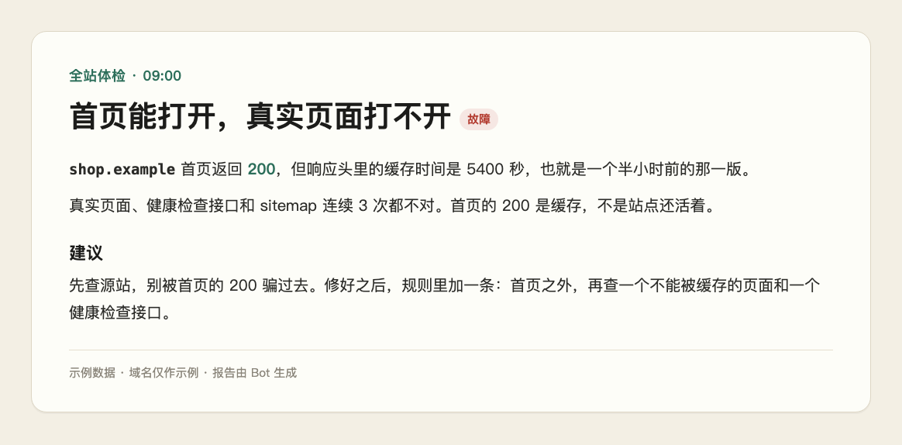

import { Steps } from '@astrojs/starlight/components';
import Figure from '../../../components/Figure.astro';
import Diagram from '../../../components/Diagram.astro';

Once a day, one line arrives in chat: "All normal." When a site is down, slow, or its certificate is about to expire, the message explains what broke and how to fix it.

<Figure name="site-check" alt="A shopfront. The robot lifts the window display, revealing a dark empty interior and a loose plug. A faded copy of the display floats above, and the robot holds a three-dot checklist." />

Here is a sample report with made-up data:



## A 200 does not mean the site is alive

One day it found a site whose homepage opened but whose real pages did not. The homepage returned 200 and looked fine, but it came from a cache. The real pages, a health endpoint and the sitemap were wrong.

That is why the brief should add two rules. Check a page that cannot be cached and a health endpoint as well as the homepage, and record the cache age and cache status whenever the homepage returns 200.

## Two near misses

On the first run, one site timed out. It did not report a failure, but checked again and the second attempt was fine. The rule has been "report only if both attempts agree" ever since.

Another site returned 404 for its sitemap, but robots.txt declared sitemap-index.xml, which opened fine. That was not counted as a failure.

On another run it listed certificates that had not yet reached the 21-day alert line. This list is only an early look; at the alert line they are reported as items to handle. Sites on automatic renewal usually need no attention unless renewal fails.

<Diagram name="site-check" alt="Flowchart: the routine checks the homepage, an uncached page, an endpoint and the sitemap. When nothing is wrong it answers with one line. When something looks wrong it checks once more and reports only if both attempts agree." />

## What to tell the bot

```text title="Request for the bot"
You are my site checker. Check the addresses I give you once a day and report only the result.

Scope (I will send the addresses after this):
- the homepage of each site;
- one page on each site that is never cached;
- one health endpoint on each site;
- robots.txt and the sitemap it declares.

For each one, check four things:
1. Status code and redirect chain, and the address it ends on.
2. Time from request to the end of the response headers.
3. Days until the certificate expires, and whether the certificate matches the host.
4. Whether the homepage was served from cache, and how old that copy is.

Rules:
- Over 5 seconds is slow. A certificate with less than 21 days left needs attention. 4xx and 5xx are failures.
- If anything looks wrong, check once more. Report only when both attempts agree.
- If the homepage is fine but a page, endpoint or sitemap is not, report it as a failure and say that caching may be hiding it.

Report:
- When everything is fine, reply with one line: "All normal." No list, no process.
- When something is wrong, lead with the conclusion, then group by root cause. Each item says what broke, what it affects, and the cheapest fix.
- Merge several sites caused by the same fault into one item.
- Do not paste full pages, command output or logs.

Constraints:
- Read only. Do not change settings, restart services, open tickets or contact anyone.
- Never print secrets, tokens or account details in the chat.
- Back up before changing any config. Ask me before changing DNS, routing or time zone.
- When unsure, stop and tell me what you want to do.
- If a tool is missing, tell me what to install. Do not pretend the check ran.
```

## Only you can do this

<Steps>

1. **List the addresses.** Four per site: the homepage, a page you have confirmed is never cached (check the response headers first), a health endpoint, and robots.txt. Write "none" when a site has no endpoint.

2. **Set the thresholds.** 5 seconds and 21 days by default. On a slow link or a site far from the server, relax 5 seconds to 8. Do not start with the strictest numbers.

3. **Watch the first run.** Fix the brief until the report reads right, then let it schedule a daily run. If an approval card appears, click **Allow once**.

</Steps>

## The decisions that made it work

| Decision | Recommendation | Why |
|---|---|---|
| How often | **Once a day** | Pick the delay you can live with. Once a day is a common starting point |
| What to check | Homepage, an uncached page, an endpoint, the sitemap | Checking only the homepage is how a cache hides an outage |
| Alert thresholds | 5 seconds, 21 days for certificates | Tighter numbers turn network jitter and normal renewals into noise |
| What a failure says | Root cause and the fix | You have two minutes in the morning, so the report has to be actionable |

## Where it goes wrong

**The homepage opens but real pages do not.** The homepage came from the CDN cache. Check an uncached page and an endpoint, and record the cache age from the response headers.

**First attempt times out, second one is fine.** A single timeout is usually jitter. Put "report only if both attempts agree" in the brief. Agreeing means the same address and the same check still fails on the second attempt. A different address or a different check does not count.

**The sitemap returns 404.** Read what robots.txt declares first. When it declares sitemap-index.xml, a 404 on /sitemap.xml is not a failure.

**A certificate warns a month ahead.** Set the threshold to 21 days. Sites on automatic renewal need no attention unless renewal fails.

**One fault produces several reports.** Group by root cause and report it once.

## Verify

Ask it to check now in the chat. When everything is healthy you should get the single "All normal" line. To confirm it really reports failures, give it one of your own addresses that you know returns 404, and check that the failure has the expected shape.

To keep a record, let the routine run; the **Run logs** hold the results of scheduled runs.

## Make it yours

- **Send it somewhere else:** only the sending step changes.

## Next steps

- [How to make a bot work on a schedule](/guides/routines/): time zones, cron, sleeping computers and recovery.
- [A two-minute GitHub triage every morning](/recipes/github-morning-triage/): another job that suits a duty bot.
