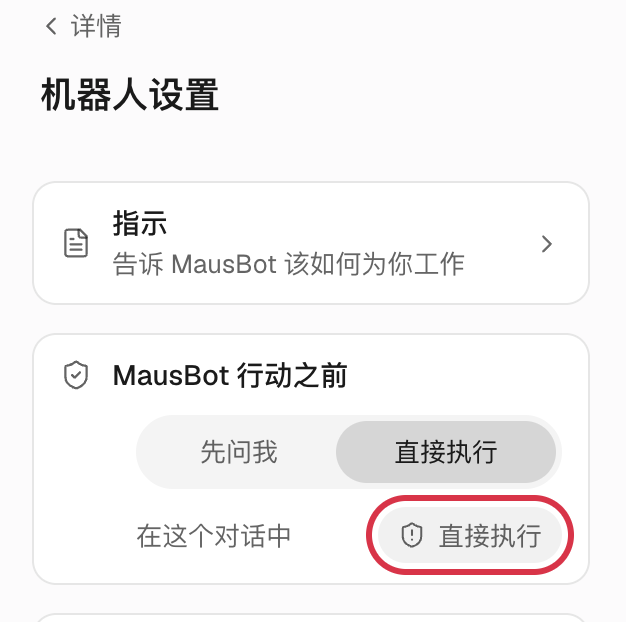
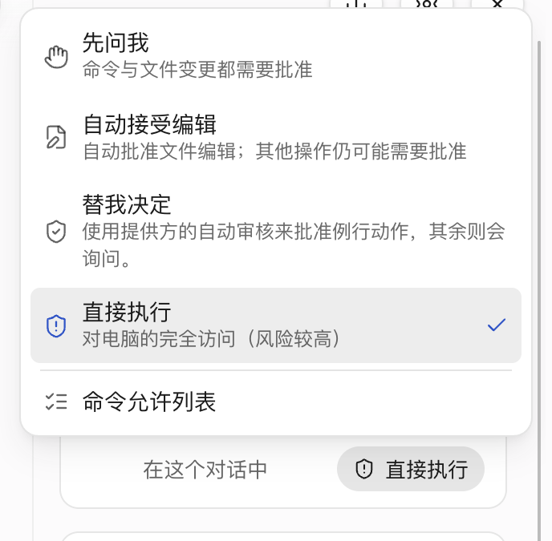
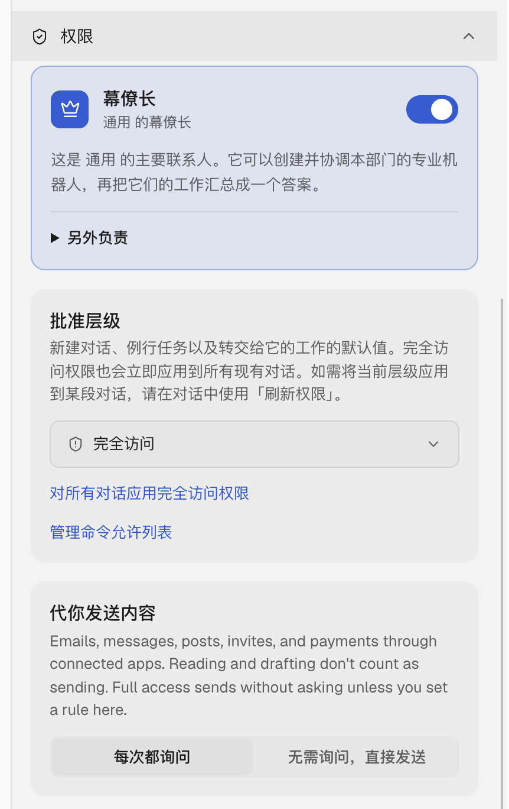

import Figure from '../../../../components/Figure.astro';
import Diagram from '../../../../components/Diagram.astro';


**新建的 Bot 默认不问你，直接做。** 执行命令、改文件、操作电脑，都不会先弹卡片。这是 OpenMausBot 自己的默认设置，没单独设过级别的 Bot 新开对话也一样。公司托管的共享工作区是例外，那里默认是「先问我」。

这篇讲四档分别拦什么、什么样的 Bot 该设哪一档，以及怎么改。看完你就能判断：万一某个 Bot 出了岔子，最坏能弄坏什么。

<Figure name="approval-gate" alt="四道由窄到宽的门并排：一个机器人停在窄缝前，一个在栏杆前出示卡片，一个正穿过闸机，一个径直走过敞开的大门。" />

## 两种界面，两套名字

OpenMausBot 有简洁和高级两种界面，同一档在两边叫法不一样。第一次在一台设备上打开 App，默认是简洁模式；升级前就在用的设备，会保留原来的高级模式。在 **设置 → 通用 → 高级模式** 可以随时切换，只影响当前这个浏览器或桌面 App。

| 简洁模式 | 高级模式 | 团队文件里写 | 它会问你什么 |
|---|---|---|---|
| **先问我** | **请求批准** | `ask` | 用引擎自己的受监督模式：通常执行命令、改文件之前都问（Codex 例外，见下）。最保守的一档 |
| **自动接受编辑** | **自动接受编辑** | `edits` | 改文件不问，其他操作仍可能要问。只有 Claude、Grok、Antigravity、Qwen、Gemini 提供 |
| **替我决定** | **代我批准** | `auto` | 交给引擎自带的自动审核：常规操作放行，拿不准的问你，联网搜索不问。Codex、Claude、Cursor、Grok、Qwen 支持自动审核，能不能用还看模型和账号；用不了时退回到询问，已保存的授权和其他豁免照样有效 |
| **直接执行** | **完全访问** | `full` | 不问。新建 Bot 和新对话的默认值 |

表里说的是引擎发来的常规审批请求。有几类例外不归它管：Bot 读自己的文件，满足下文的条件时任何级别都不问；Bot 改自己的设置在任何级别都直接生效；登录、验证码、付款、密钥这类只有你能处理的事总会来问你；通过已连接的应用发送内容另有一道确认。下面几节分别讲。

Antigravity 是个例外：它的菜单里写的是「自动（完全访问）」，没有自动审核，选它就等于直接执行。

另外，Codex 还有一档 **自定义**，直接沿用你 Codex 的 `config.toml` 里的审批和沙箱设置，只能在桌面 App 里选。

有几点容易搞错：

- 「自动接受编辑」不是所有引擎都有，OpenCode 和 Codex 没有这一档。
- Codex 上「先问我」本身就能改文件，它是在自己工作目录的沙箱里改，所以没有单独一档「自动接受编辑」。
- Bot 改自己或队友的资料、模型、技能、团队设置和团队记忆，在**任何级别**都会立刻生效，不弹审批卡片；撤销有意义的改动，会给你一条带撤销按钮的提示。删除队友也走这条路。唯一的例外是 MausBot Cloud 上由访客或 webhook 发起的对话：那里的改动要等主人确认。

## 「直接执行」管不到的事

- 系统的隐私权限、登录、验证码和多重验证。
- 服务商那边的账号和权限，以及工作区和团队的所有权。
- 电脑共享的授权。它只决定「要不要弹审批卡片」，不会替你登录，也不会替你开通权限。
- 登录、验证码、付款、密钥和你自己的账号这类事，它还是会来找你。其他问题如果出在别的 Bot 派下来的工作里，派活的 Bot 可能替你回答。「直接执行」不代表它什么都能自己搞定。

通过已连接的应用**发送**内容（邮件、消息、邀请、付款）另有一道确认，由 Bot 的「代你发送内容」决定：选「每次都询问」，每次发送都要你点头。选「无需询问，直接发送」，直接发出。没设过的话就看审批级别：「直接执行」下直接发，其他级别会单独问你。这个设置在高级模式的 **权限** 里。读邮件和写草稿不算发送。

## 有些事任何级别都不问

Bot 读**自己的**文件，满足下面的条件时通常不需要批准：它的指示（文件是 `SOUL.md`）、技能和每个保存过的版本、记忆、会话目录。前提是命令只由普通的词组成，用的是受支持的参数和写法，并且是 `cat`、`head`、`tail`、`grep`、`rg`、`sed -n`、`ls`、`wc`、`nl`、`stat` 这类只读命令，或者 Claude 的 Read、Grep、Glob、LS、NotebookRead，而且所有路径（跟随链接之后）都在它自己的目录里。

命令里只要多了管道、重定向、第二条命令、变量或通配符，就会照常按级别处理。别人（访客）的回合不享受这项豁免，按「先问我」处理，因为那个目录里存着主人的记忆。

在你自己的电脑或服务器上，每个 Bot 的命令都以运行 OpenMausBot 的那个系统账号执行。到了「直接执行」，那个账号能读的文件 Bot 都能读，包括 SSH 密钥。所以与其指望审批级别，不如把 Bot 放到一个专用账号上：只要那个账号读不到你的个人文件，Bot 在这台服务器上执行的命令也就读不到。不过 Bot 如果被允许操作别的电脑、或者连了应用，还能通过那些途径碰到别处的资料，要另外看。

## 哪种 Bot 该用哪一档

| 这个 Bot 干什么 | 建议 |
|---|---|
| 跑定时任务、由 webhook 触发、无人值守 | **直接执行（完全访问）**，前提是它碰不到生产环境、个人文件和凭据，碰得到的看下一行。定时任务和 webhook 触发的回合也按 Bot 的级别运行，设成「先问我」，遇到要审批的操作就会停下来等一张没人批的卡片，引擎等超时还会直接停止 |
| 会碰生产环境：能部署、能动数据库、能改线上配置 | 至少 **先问我（请求批准）**，或者只给它一个只能读的账号 |
| 日常聊天、写东西、查资料 | 直接执行也行；想更稳就设先问我，代价是多点几次 |
| 装在你自己的 Mac 上 | 从严。Bot 以你本人的账号运行，能读到你的个人文件 |

**没人看着的 Bot 没法先问你。** 定时任务跑到一半停下来等人，比不跑还糟。所以别把所有 Bot 都设成最保守，**把能碰生产环境的和碰不到的分开**，前者管严，后者放开。

<Diagram name="approval-flow" alt="决策流程：Bot 碰不到生产环境、个人文件和凭据，就用直接执行；碰生产环境时，有人看着用先问我，没人看着用只读账号。" />

图里「要紧的东西」指生产环境，也包括这个 Bot 能碰到的个人文件、账号和凭据。

## 怎么改

### 简洁模式

**改一个 Bot 的默认级别：**

1. 打开和这个 Bot 的对话，点顶部中间的 Bot 名字，右边会打开它的资料。
2. 点资料右上角的齿轮图标，进入 **机器人设置**。
3. 找到 **「Bot 名」行动之前** 这张卡片，点 **先问我** 或 **直接执行**。切到另一档时，这个 Bot 所有已有的对话也会一起改。



这里只有两档可点。Bot 如果正处在「自动接受编辑」或「替我决定」，会多出一格灰色的显示当前级别。

**只改这一段对话：** 上图红框里的按钮，就是 **在这个对话中** 右边那个，显示的是当前对话用的级别。点它会弹出菜单，可选的档位取决于引擎和运行环境，选完只影响这一段对话：



### 高级模式

1. 在左侧栏点 Bot 右边的 **…**，选 **编辑资料**。
2. 展开 **权限**，在 **批准层级** 里选。



高级模式里这样改的是**新对话**、例行任务和转交给它的工作的默认值。选「完全访问」会立刻用到所有已有对话；选其他档，已有对话保持原来的级别。只改一段对话，用对话输入框旁边的审批按钮。

### 一次改很多个

- **整个部门**：侧边栏部门菜单里的 **为此部门的所有机器人设置…**，会先列出每个 Bot 会变成什么，再逐个保存，改到的 Bot 所有对话都会改。引擎不支持这一档的 Bot 会被跳过，结果里会写原因。
- **批量**：用[团队文件](/zh/guides/team-file/)，每个 Bot 写一行 `approval:`。

:::caution[总协调机器人会把自己的级别往下带]
Chief of Staff（总协调机器人）用 `coordinate_bots` 派出去的活，会带上它自己对话的级别，而且一层层往下传。但只往高处带：接手的 Bot 本来级别更高、或者用的是「自定义」，就保持不变；下传的是「自动接受编辑」而接手的引擎没有这一档时，也保持自己的级别；总协调机器人自己是「先问我」时什么都不传；只是请教问题（不让对方动手）时不带级别；由外部事件触发的工作也不带。所以把总协调机器人设成「直接执行」，等于它手下的 Bot 替它干活时也放开了；想收紧，要把总协调机器人和每个 Bot 自己的级别都调低。普通 Bot 之间转交的活，按接手那个 Bot 自己的级别运行。
:::

**Bot 正在干活时改级别也会生效**，生效时机看引擎：
- 接口类引擎（OpenAI 兼容接口、Grok API、Mistral 等）：下一次工具调用起生效，调高调低都一样。
- 自带权限模式的引擎（Codex、Claude、Cursor、Antigravity、Qwen Code、Gemini CLI 等）：调到「直接执行」从下一次请求起生效。调低，或在另外三档之间切换，一般从下一轮开始。
- 由 OpenMausBot 代答审批的 Agent（OpenCode、Kimi 等）：下一次请求起生效。

已经弹出来的卡片仍然要你处理，已经在跑的动作会跑完。例外：从「直接执行」紧急降回「先问我」并应用到所有对话的那条路径，会立刻撤销权限，并停掉这个 Bot 正在跑的那一轮。

## 审批卡片上有什么

执行命令、改文件、调用工具的卡片上有 **允许一次** 和 **拒绝**。按请求的类型，最多再多一个 **始终允许** 按钮。按钮上的字都一样，管多大范围要把鼠标停在上面看提示，分三种：

- 调用你配置的自定义 MCP 服务器上的读取类工具时：以后这个 Bot 用同一个引擎实例再调这个工具，不再问你；改了服务器的命令、地址、请求头或凭据就失效。写入类工具、操控电脑、访客的回合都没有这个选项。
- 执行命令时（提示叫「始终允许此命令」）：这个 Bot 以后用同一个引擎、在同一个文件夹里跑一模一样的命令，不再问。
- 引擎支持时（提示叫「本次会话一律允许」）：在这次会话结束前，引擎不再就这个动作问你。API 类引擎没有自己的会话，这项允许只对这个 Bot、这个工具、这个服务器、这段对话剩下的部分有效，记在内存里，服务器重启后就失效。

点 **拒绝**，Bot 会看到被拒绝。每次批准都会记进决定日志，包括那次是「没人在键盘前」的定时任务、webhook 或其他 Bot 发起的。

## 想全部用「直接执行」的话

至少做到两件事：**Bot 用专用账号运行**，以及**别让它有机会碰生产凭据**。这两点比审批级别更管用。

## 让 AI 帮你审一遍

```text title="提示词"
读一下我的 OpenMausBot 服务器（ssh 别名 "myserver"）现在每个 Bot 的审批级别：
`openmausbot team export --out /tmp/team.yaml`，看其中每个 Bot 的 approval 字段。
再查运行 OpenMausBot 的那个系统账号能读到哪些地方（工作目录、主目录、~/.ssh、云服务配置），看有没有部署脚本、云服务密钥、SSH 私钥或数据库连接串；查不到的地方标成「未知」。

给我一张表：Bot、审批级别、工作目录、它能碰到的敏感东西、建议的级别（保持 full / 改成 ask / 换个只读账号），
按风险从高到低排序。导出会在 /tmp 写出团队文件和旁边的技能文件，这没关系；不要改任何 Bot 和设置，先只给我看。
```
