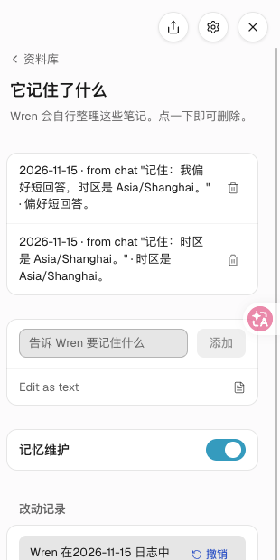

import { Steps } from '@astrojs/starlight/components';
import Figure from '../../../../components/Figure.astro';

每天早上都要重新告诉 Bot 一遍你的时区？先别猜它记没记住，直接打开存记忆的那个文件看一眼就清楚了。

Bot 的记忆就是运行 OpenMausBot 那台机器上的纯文本 Markdown。你能打开、能改、能删掉一行。这一页存一个偏好，看它落在哪，再把它删掉。

<Figure name="memory-linocut" alt="木刻版画：一只机器人在带日期小方格的横线本上写字，另一只机器人用橡皮擦掉其中一行。" />

## 先做决定

| 它是什么 | 放在哪里 | 原因 |
|---|---|---|
| 长期有效的偏好或事实（短回答、Asia/Shanghai） | Bot 记忆 | 每次对话都会带上，除非记忆关闭、条目过期或超出上限 |
| 每个 Bot 都该知道的关于你的事实 | 设置里的 **关于我** | 所有 Bot 都读 |
| 有步骤的流程 | skill | 开启后会带入索引（最多 30 个、4,000 字节），正文按需读取 |
| Bot 是谁、能做什么 | 固定指示 | 设在 Bot 自己身上，不随任务变 |

记忆只放长期成立的东西。Bot 自动提取关于你的事实时，一次任务、一个临时问题、一句「假设……」，都不算事实。

## 交给 AI Agent

直接用你自己的话在聊天里说。存了什么，看面板。

```text title="发给 Bot 的需求"
记住两件事：我偏好短回答，时区是 Asia/Shanghai。

然后告诉我你写了哪几行。
```

以后要删掉一条：

```text title="发给 Bot 的需求"
忘掉 Asia/Shanghai 这条记录。
```

「忘掉」按笔记正文里的词匹配，不看它当初来自哪段聊天。比对前会先统一大小写、全角半角和引号样式，再把你说的那段话当成完整词组来找（至少三个字母或数字，所以「IST」不会误删「dentist」）。

命中后，包括这个 Bot 自己的记忆都会被删掉。标题、frontmatter 这些结构部分不会被删，中文词如果紧贴着其他汉字也可能漏掉，删完最好瞄一眼剩下的内容。如果你是在自己的**一对一聊天**里说的，**关于我** 里对应的记录也会一起删。

## 自己动手

<Steps>

1. 打开和这个 Bot 的对话，再打开它的资料，进入 **资料库 → 它记住了什么**。面板列出的是 Bot 记住的笔记，不只是 `MEMORY.md` 的原文；能删的行右边有删除按钮。每次对话真正加载的，是 `MEMORY.md` 去掉过期条目后的前 200 行或 24 KB。

2. 点 **Edit as text**（中文界面里这一项目前仍显示英文）打开纯文本原文。如果编辑期间 Bot 刚好改过这份文件，保存会被拦下，但你写的草稿会留在屏幕上，不会丢。

3. 面板下面的改动记录列出编辑，带 **撤销**，包括 Bot 在某一轮里自己改的。有些记录不能撤销，并会写明原因：例如旧内容里有凭据，或旧内容太大存不下。

</Steps>



有两个上限要留意。每次对话加载 `MEMORY.md` 时，会先去掉过期条目，再取前 **200 行或 24 KB**，先到哪个算哪个，超出的不读。

文件被新内容写满时，旧条目可能会被挪进 `memory/archive.md`（挪走后依然搜得到），顺序是先划掉的、再过期的、最后最早的带日期条目。刚写进去的、未划掉且未过期的核心事实，以及你自己手写的不带日期的行，都不会被挪走。如果腾不出足够空间，也可能一条都不动。

## 需要你亲自做的

<Steps>

1. 判断什么算长期。时区、饮食、客户名字、偏好的格式算。写一份发布计划不算。

2. 隔一段时间读一遍。记忆里一条错的事实，会影响之后的回答，直到有人删掉它。

3. 不要把密钥放进去。通过应用写入时，像 key 和密码的内容会被自动替换掉，但有文件权限的 Bot 可以直接改文件。别把 token 往记忆里放。

</Steps>

## 验证

1. 这一次运行里，面板每个事实一行，带日期和它来自哪段聊天。你自己手写的行不一定会按笔记显示，原文以磁盘文件为准。
2. 默认数据目录下，`MEMORY.md` 在 `~/.openmausbot/workspaces/<bot id>/MEMORY.md`；主题文件在旁边的 `memory/` 目录。
3. 新开一段对话，问「你记得我什么」。回答只能当参考，到底记没记住看面板或文件。

## 常见问题

**Bot 说记住了，文件却是空的。** 看面板，不要看回复。口头确认不等于写入成功。

**一个事实在一个 Bot 里有，另一个没有。** 记忆属于单个 Bot。所有 Bot 都该知道的，放 **关于我**。

**文件超过 200 行。** 每轮会先去掉过期条目，再加载前 200 行或 24 KB，先到哪个算哪个。把细节移到主题文件里，或者 Bot 提示整理时按它的提示做。

**删掉的事实又回来了。** 在面板里删除，和在聊天里让 Bot 忘记，是两种操作。面板删除只处理这一行；想按这些词清一遍，在**一对一聊天**里让 Bot 忘记。之后再明确保存相关内容，遗忘状态会被清除，所以删完要检查剩余内容。

**想关掉记忆。** 在 Bot 设置的记忆区，Bot 空闲时关掉 **允许这个机器人使用记忆**。`MEMORY.md` 不再加载，自动回忆也停。文件仍然留在磁盘上，有文件权限的 Bot 仍然能直接改它们。截图里的 **记忆维护** 是另一个开关。

## 下一步

- [把重复的活变成 skill](/zh/guides/skills/)：流程不是记忆。
- [三个 Bot 接力](/zh/recipes/three-bot-team/)：每个 Bot 有自己的记忆。
- [审批层级](/zh/concepts/approval-levels/)：哪些操作仍然会出卡片。
