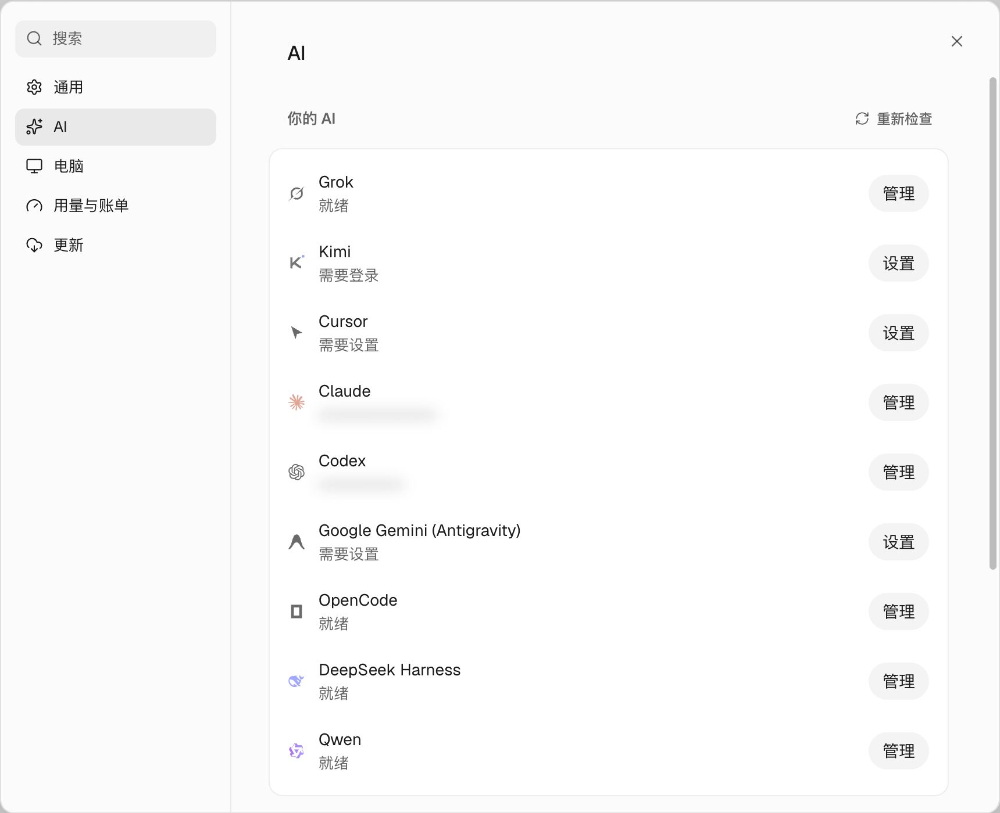

import Figure from '../../../../components/Figure.astro';
import Diagram from '../../../../components/Diagram.astro';

引擎就是 Bot 背后实际运行的 Agent CLI：`claude`、`codex`、`opencode` 等等。在服务器上，每个引擎都要**在服务器上**单独登录，因为进程在那里运行。CLI 可以在 **设置 → AI** 里一键安装（装在 `~/.openmausbot/tools`），也可以自己用 npm 装。装好后都要在服务器上登录。

<Figure name="sign-in-engines" alt="层叠剪纸画：机器人扛着一把大钥匙，从发光的手机走向一台没有屏幕、只有一道窄缝的服务器，腰间还挂着五把形状各异的钥匙。" />

## 前提条件

- 一台 OpenMausBot 服务器，这台电脑能用 `ssh myserver` 登录（见[如何用家里的小主机 24 小时跑 OpenMausBot](/zh/guides/home-server/)）。
- 你要接入的每个引擎的订阅账号或 API key。

下文的 `myserver` 是服务器的 SSH 别名，`<…>` 是要换成你自己的值。

## 先做决定：先接入哪个引擎

按在没有显示器的机器上登录的难易程度排序：

| 引擎 | 登录方式 | 无界面登录难度 | 前提 |
|---|---|---|---|
| **OpenCode** | API key（在 opencode.ai 控制台复制，服务器上用 `opencode auth login` 粘贴） | 简单 | OpenCode Go/Zen；什么都没有也行（有免费模型） |
| **Codex** | 设备码（在网页上输一个码） | 简单 | ChatGPT 订阅 |
| **Kimi** | 设备码 | 简单 | Kimi Code 会员 |
| **DeepSeek Harness** | API key | 简单 | DeepSeek API key（按量计费） |
| **Claude Code** | 打开登录页，把页面上显示的代码粘回来 | 中等 | Claude Pro 或 Max 等付费账号 |
| **Antigravity（Gemini）** | 浏览器登录 Google，把跳转后打不开的那个页面地址粘回来 | 较难 | Google 账号 |

建议先接一个简单的引擎（OpenCode 或 Codex），发一条消息把流程跑通，再去接麻烦的。

OpenCode 还有免登录的免费模型，用来测试流程不错，正式干活就别用了。

<Diagram name="signin-spectrum" alt="服务器上的四种登录方式，从易到难：设备码（Codex、Kimi）、API key（OpenCode、DeepSeek）、打开链接粘授权码（Claude Code）、浏览器登录粘回调地址（Antigravity）。" />

## 交给 AI Agent

```text title="提示词"
在我的 OpenMausBot 服务器（ssh 别名 "myserver"）上把引擎登录好。我要的是：<引擎，比如 OpenCode Go 和 Codex>。

- OpenCode 要用 API key：让我自己 `ssh myserver` 进去运行 `opencode auth login`，选 OpenCode Go 并粘贴 key，你不要经手这个 key。
- 用设备码登录的引擎，在服务器上发起登录，只把我需要打开的网址和要输入的码给我。
- 每登录完一个引擎：在服务器上运行 `openmausbot models`，确认能看到它的模型；然后选这个引擎的一个模型，跑
  `openmausbot run "MausBot" "只回复：OK"`。
- 如果我指定了新 Bot 的默认模型，就设成 <模型>。

绝不回显 API key、token 或认证文件。如果某一步需要在浏览器里操作，停下来，明确告诉我要点什么。
```

## 需要你亲自做的

- **在浏览器里批准每一次登录：** 输入设备码（Codex、Kimi），或者打开登录页、把页面上显示的代码粘回来（Claude）。要用有订阅的那个账号。这几种也可以在 **设置 → AI** 里点对应引擎的 **设置**，在浏览器里完成，不用开终端。
- API key 自己粘贴到 **设置 → AI → API 密钥**，不要发进和 Agent 的对话。OpenMausBot 保存后不会再显示明文，只把它交给对应的引擎进程。

## 验证

打开 **设置 → AI**，登录好的引擎列在 **你的 AI** 下面，显示账号邮箱或 **就绪**。再到任意对话顶部的模型选择器里，确认能看到它的模型。



## 常见问题

- **两个服务商，模型名几乎一模一样。** 在 OpenCode 里，`Go · DeepSeek V4.1 Flash 1017` 走的是你的 Go 订阅，`Zen · DeepSeek V4.1 Flash 1017` 按用量从 Zen 余额里扣钱。认前缀，别只看名字。
- **Claude 登录失败。** 在 **设置 → AI** 里重新点 Claude 的 **设置**，打开完整的登录页，确认浏览器里登录的是要用的那个 Claude 账号，再把页面上显示的代码整段粘回去。
- **Antigravity 不会复用你现有的 agy 登录。** OpenMausBot 自己安装一份 Antigravity 运行时，和 Antigravity App、`agy` 命令行分开，要在 **设置 → AI** 里安装并用 Google 账号重新登录。每份安装对应一个 Google 账号。
