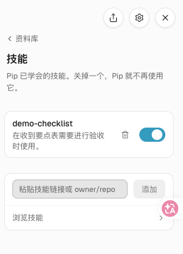

import { Steps } from '@astrojs/starlight/components';
import Figure from '../../../../components/Figure.astro';

下面说的 skill，就是界面里的「技能」。

同一份检查清单，这周已经跟 Bot 说了三遍。做成 skill 就不用每次重讲：把步骤写进一个短文件就行。无论是 Bot 自己写的还是从 skill 库分给它的，只要开着，名字、描述和路径就会出现在索引里（超出上限的除外），提示它在做相关任务前先读正文。

这一页把「验收一份交接文件」做成 skill，再用下一个任务检查它有没有照做。整个过程就是一个文件，加一个开关；如果 Bot 的权限层级要求审核，还要多一次审核。

<Figure name="skill-blueprint" alt="蓝图风格：一只机器人把长纸条折成有三道折痕的卡片，另一只机器人把同一张卡片展开，指着纸面。" />

## 先做决定

| 你想留下的东西 | 放在哪里 | 原因 |
|---|---|---|
| 有步骤、有完成标准的流程 | skill | 开启后带入索引，正文按需读取 |
| 一个事实或偏好（短回答、Asia/Shanghai） | 记忆 | 记忆开启且没超出预算时，这个 Bot 可以用到 |
| Bot 是谁、能做什么的规则 | 固定指示 | 设在 Bot 自己身上，不随任务变 |
| 到点该做的事 | 例行任务 | skill 说怎么做，例行任务说什么时候做 |

如果这段流程每次都不一样，先别做 skill。等它第三次长得差不多，再写下来。

## 交给 AI Agent

把下面这段发给支持写 skill、并且已开启 skill 撰写的 Bot。让它写文件，并告诉你放在哪。

```text title="发给 Bot 的需求"
把下面这段流程写成 skill，名字叫 demo-checklist：

1. 文件存在。
2. 字数在我要求的范围内。
3. 最后一行写明事实来源。

description 用一句话写清什么时候该用，例如「收到要点表、需要验收时使用」。
正文控制在 20 行以内。
写完告诉我 skill 名和 SKILL.md 的完整路径。
```

名字是 1 到 64 个字符，只能用小写字母、数字和单个连字符。description 帮助 Bot 判断要不要读正文，所以要写成「什么时候」，不要写成「关于什么」。

如果这段流程需要权限才能跑，先别做成 skill。skill 能说怎么做，但不能给 Bot 它本来没有的权限。

## 自己动手

<Steps>

1. 这一页用简洁界面。打开和这个 Bot 的对话，再打开它的资料，进入 **资料库 → 技能**。

2. 如果是导入现成 skill：粘贴 GitHub 仓库或 GitHub 上的 `SKILL.md` 链接、skills.sh 链接，或者 owner/repo，点 **添加**。这样导入的 skill 默认是关的，先读再开。高级模式里，打开这个 Bot 自己的设置，进入 **技能**：skill 库开着就从库里添加，没开就粘贴链接后点 **导入**。

3. 如果是自己写（本页的做法）：按下面的格式写好正文发给 Bot，让它保存成 skill，再去面板里确认。Bot 直接应用的新 skill 默认已经打开。如果是更新已有 skill，或者改动还在等待审核，去面板里检查开关。

</Steps>

```text title="SKILL.md"
---
name: demo-checklist
description: 收到要点表、需要验收时使用。
---

# 交接验收

1. 确认消息里给的路径上文件存在。
2. 数一遍字数，和要求的范围比较。
3. 读最后一行，它必须写明事实来源。
4. 只回一行：通过，或第一条没过的检查。
```



用默认数据目录时，Bot 自己写出来的 skill 可能在 `~/.openmausbot/workspaces/<bot id>/skills/<name>/SKILL.md`，也可能在旁边的修订目录里。来自 skill 库的 skill 从库里读。以索引里的路径为准。

## 需要你亲自做的

<Steps>

1. 定触发点。「用于验收」太虚，「收到要点表、需要验收时使用」才是 Bot 能匹配的时刻。

2. 开之前读一遍正文。skill 本质上是给 Bot 的指令。审查扫描器会标记「下载后直接交给 shell 执行」、长编码文本和不可见字符，但这些只是提醒，不会自动拦截。

3. 决定给谁用。Bot 自己学到的 skill 默认只归它自己。共享后会进 skill 库，并分配给队里符合条件的 Bot。只要已启用、已分配且没超索引上限，新对话会在索引里看到它，正在聊的对话也可能收到一条带路径的提示。如果某个 Bot 自己已经有同名 skill，会保留它自己的那份。

</Steps>

## 验证

1. Bot 的 **资料库 → 技能** 里能看到这个 skill，开关是开的。
2. 发一个匹配的任务，看它有没有按你写的检查来做。这次演示里回答按三条检查的顺序走过；具体措辞由模型决定，不是固定模板。
3. 再发一个不相关的任务。如果回答里出现检查清单，检查一下 description 是不是写宽了。

## 常见问题

**Bot 从来不用它。** description 写成了主题而不是触发点，或者开关关着。改成「当……时使用」，再发一个能对上的任务。

**Bot 读错了副本。** 它报的路径不是你想要的。问它读了哪条路径。面板只显示名字，不显示路径；如果 Bot 自己的 skill 和 skill 库里的 skill 同名，Bot 自己的那份优先。打开它读到的那份确认。

**导入的 skill 没反应。** 从链接或仓库导入的 skill 默认关闭。到 Bot 的 skill 面板打开，或者在 skill 库里打开后再分配。

**skill 列表被截断。** Bot 自己的 skill 和 skill 库的索引最多 30 个、约 4,000 字节，超出的会告诉 Bot 有遗漏。把这个 Bot 用不到的关掉。

**skill 写了它做不到的事。** skill 只管步骤，不给权限。流程里需要什么权限，还是得在 Bot 自己身上开。

## 下一步

- [三个 Bot 接力](/zh/recipes/three-bot-team/)：交接类 skill 放在接力里怎么用。
- [让 Bot 按时间表工作](/zh/guides/routines/)：把同一段流程变成每天的任务。
- [审批层级](/zh/concepts/approval-levels/)：skill 仍然绕不过哪些卡片。
