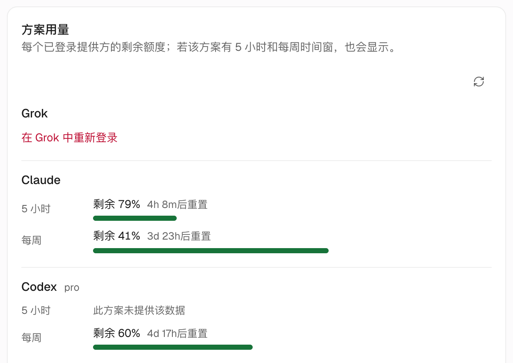

import Figure from '../../../../components/Figure.astro';

如果你和我们一样，同时买了 Claude、ChatGPT（Codex）、Google AI（Antigravity）和 OpenCode Go 的订阅，平时就得在几个 CLI 之间来回切，额度都用不完，也说不清哪件事该交给谁。

换成 OpenMausBot，每份订阅对应一个或几个 Bot，你在同一个聊天框里给它们派活就行。它调用的就是你电脑或服务器上已经登录好的 CLI，不用注册新账号，也不经过第三方中转。

<Figure name="subscriptions" alt="左边四个机器人各连着一根不同颜色的线，四根线汇成一根绿线接进同一个聊天气泡，一根手指正点着气泡。" />

## 我们的 Bot 是这么分工的（2026 年 11 月）

| 引擎 / 订阅 | 模型 | 负责什么 | 为什么选它 |
|---|---|---|---|
| OpenCode Go | DeepSeek V4.1 Flash | 默认 Bot、数据日报、各类杂活 | 订阅制、便宜、快，中文好，适合天天跑 |
| Antigravity（Google AI） | Gemini 3.8 Flash | 研究、话题追踪 | 多模态强，看视频、读网页都行 |
| Claude Code / Codex（Mac 上另跑一套） | Claude、GPT 系列 | 写代码、重活 | Mac 上已经登录好，打开就能用 |

Mac 上，默认的总协调机器人和一个做日常的 Bot 用 Claude Sonnet 5，一个干重活的 Bot 用 Opus 5.5，写代码用 Codex，两个跑零碎任务的 Bot 用 OpenCode Go 的 DeepSeek。这几个模型在同一台机器上同时跑，互不影响。

天天跑的活用便宜的订阅模型，偶尔才做的重活用强模型。这样每份订阅的额度都用得上，不会逮着一份使劲薅。

## 怎么接入

- 在 Mac 上，你本机已经登录的 `claude`、`codex` 会被自动识别，打开 App 就能用，请参阅[15 分钟上手](/zh/start/)。
- 在服务器上，每个引擎要登录一次。Codex 和 Kimi 用设备码（device code）登录最省事。OpenCode 可以把 Mac 上的登录通过管道直接搬过去，请参阅[如何在服务器上登录引擎](/zh/guides/sign-in-engines/)。
- 任何 OpenAI 兼容接口（DeepSeek 官方 API、本地的 LM Studio）都可以在设置里添加为一个引擎，不用写代码。

接入后，打开任意对话顶部的模型选择器，就能看到这台机器现在能用哪些模型。

## 给 Bot 换模型

打开和这个 Bot 的对话，点顶部的模型选择器，选一个新模型，再在 **应用模型更改到** 里选范围：

- **仅此对话**：只换这一段对话，其他对话不受影响。
- **对话 + 机器人默认**：这个 Bot 以后默认都用新模型。

想一次换一批，在侧边栏打开部门菜单，选 **为此部门的所有机器人设置…**，到 **模型与思考强度** 里改。

Bot 在服务器上的话，也可以把下面这段发给你的 AI Agent：

```text title="提示词"
把我 OpenMausBot 服务器（ssh 别名 "myserver"）上「<Bot 名>」的默认模型换成 <想用的模型>。
先用 openmausbot models 查出准确的模型名，不要猜。换完告诉我新旧模型分别是什么。
```

:::caution[名字一样，扣的钱不一样]
OpenCode 里，`Go · DeepSeek V4.1 Flash` 走的是 Go 订阅，`Zen · DeepSeek V4.1 Flash` 按 token 扣 Zen 余额。选模型时看清前缀。
:::

## 看看额度花在哪了

**设置 → 用量与账单** 顶部只显示用得最多的那个方案。点开 **查看全部限额**，往下找到 **方案用量**，每个已登录的方案一行，列出还剩多少、什么时候重置。



有几处容易看错：

- Claude 同时报 5 小时和周窗口，各有重置倒计时。
- 我们的 Codex Pro 方案只报周窗口，5 小时那一行写的是「此方案未提供该数据」。这不代表没登录。OpenMausBot 显示的是 OpenAI 给这个方案返回的窗口，你的方案可能不一样。
- 同一个订阅可能出现两行。我们的机器上同时装了 Codex 和 ChatGPT 两个实例（背后是同一个 `codex` 命令行），用量页把它们分开列，数字一样。
- 按量计费的接口显示「本月花费」和按模型的明细，订阅类方案显示的是百分比。

哪份订阅还有大把额度没用，就多给它分几个 Bot。

## 后续步骤

- [在手机上看 Bot 干活、随时审批](/zh/recipes/phone-remote-control/)：服务器在家跑，人在外面也能看进度、批卡片、按停止。
