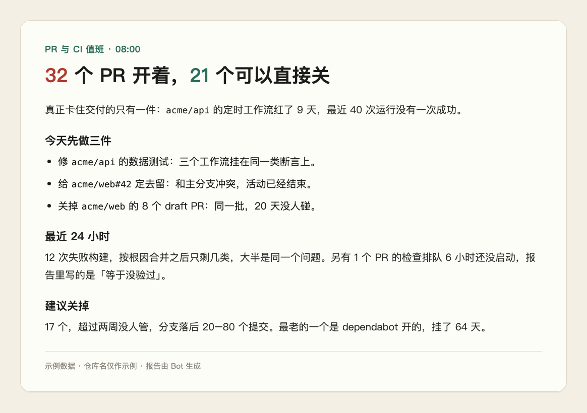

import { Steps } from '@astrojs/starlight/components';
import Figure from '../../../../components/Figure.astro';

每天早上，一条消息进聊天：多少 PR 开着，哪些能直接关，昨天哪个构建红了，今天先做哪三件。

<Figure name="github-triage" alt="等距小房间：传送带送来卡片，机器人把卡片分进绿、沙、陶三只托盘，旁边一叠很高的卡片，显示器亮着红点，墙上挂钟没有数字。" />

下面是一张示例报告，用虚构数据展示格式：



## 一条消息里有什么

结论在最前面，后面是数字和清单。

真正要注意的是卡住交付的那几件：一个长期红着的工作流、一个排队很久的检查、一堆没人管的 PR。报告把它们分开列，省得你从几十条里自己找。

## 交给 AI Agent

```text title="发给 Bot 的需求"
你是我的 GitHub 值班员，只读。

每天早上把我这几个账号下的仓库过一遍（账号我随后发给你）：
- 每个仓库还开着多少 PR，最老的那个放了多久；
- 最近 24 小时失败的构建和部署。

PR 分三类，每类给出仓库和编号：
1. 检查全绿、和主分支没有冲突，先列出来等我确认；
2. 有冲突、分支太旧，或者检查没跑完，要先更新；
3. 超过两周没人管，建议关掉，写一句为什么。

失败构建分三类：
- 同一个根因反复出现，合并成一条，写清楚是哪一步、什么错；
- 只在旧分支上失败、最新提交已经恢复的，标成自愈，不要放进今天要做的事；
- 看起来是一次性的，单独列一行。

最后只给我三件事：今天最该先处理的三件，加上建议关掉的 PR 清单。
先说结论，再给数字。不要贴完整日志。

约束：
- 只读。不合、不改、不推、不评论、不关 PR。
- 不在对话里打印 token、cookie 或任何密钥。
- 改配置前先备份。改 DNS、路由、时区之前先问我。
- 要我动手的事，写清楚在哪个仓库、点哪里。
```

## 需要你亲自做的

<Steps>

1. **登录 GitHub 命令行。** 让它在这台机器上装好并运行登录，它会给你一个网址和一次性代码，你在浏览器里输入并授权。想要硬性只读，就建一个只有读权限的细粒度 token 交给它。

2. **告诉它看哪些账号。** 一个账号也行，几个也行。要不要把 dependabot 的 PR 算进来，也一起说清楚。

3. **对一遍第一次的数字。** 它跑完，拿 GitHub 页面上的 PR 数量和最老那个对一下。对不上就让它重跑。

</Steps>

## 几个关键决定

| 决定 | 建议 | 原因 |
|---|---|---|
| 权限 | **先行为只读**，再换成只读 token | 一句「只读」只能约束行为，token 才能硬性拦住写操作 |
| 看多少仓库 | 全部，按仓库分组 | 只盯活跃仓库，会漏掉放养很久的 dependabot |
| PR 怎么分 | 能合、要修、该关 | 三类对应三个动作，看完就知道做什么 |
| 失败怎么报 | 按根因合并 | 16 次失败可能只有两个原因，逐条列出来没人看 |
| 报告长度 | 结论、三件、清单 | 早上只有两分钟 |

## 常见问题

**报告说检查通过，其实没跑。** 排队、取消、跳过都不是通过。让它把没跑完的检查单独标出来，并说清楚在等什么。

**同一个错误每天出现。** 合并成一条根因。连续多天没修，就放在最前面，写清楚影响的是什么。

**主分支也红。** 先修主分支，别在 PR 上花时间。

**dependabot 的 PR 堆到一百天。** 让它按批次建议关掉，或者给仓库配上自动合并。

**报告太长。** 把「不要贴完整日志」写进需求，只要结论、根因和三件。

## 验证

第一次跑完，拿 GitHub 上的数字对一遍：开着的 PR 数量、最老的那一个、最近失败的构建。对不上就让它重跑。

想确认它没动过仓库，看完报告后看一眼提交和 PR 有没有变化。这能发现明显的写入，但不能证明没有其他操作。跑完在定时任务的**运行记录**里能看到这一次的结果。

## 改成适合你的

- **只看一个仓库：** 把仓库名写进需求，其他不变，报告会短很多。
- **发到群里：** 早上值班报告发到团队群，比躺在个人聊天里有效。
- **批准后再动手：** 想让它顺手修 CI，就把「可以改哪几个仓库、改完要谁批准」单独写清楚。默认保持只读。

## 后续步骤

- [如何让 Bot 每天定时自己干活](/zh/guides/routines/)：时区、cron 和失败恢复。
- [每天一次全站体检](/zh/recipes/site-health-check/)：另一件适合放在早上的事。
