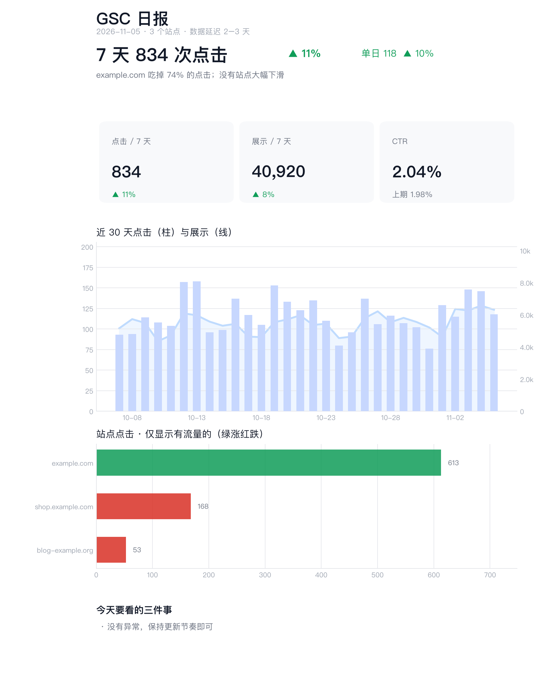

import { Steps } from '@astrojs/starlight/components';
import Figure from '../../../../components/Figure.astro';
import Diagram from '../../../../components/Diagram.astro';

每天早上 9 点，飞书群里自动出现一份日报：一句话结论、三个关键数字、30 天趋势、哪些站涨了、哪些站跌了、哪些页面只有曝光没有点击。下面这张是 Bot 用演示数据生成的同款日报：



这个 Bot 我们一直在用，每天汇总多个 Google 账号下所有站点的 Search Console 数据。从开口说需求到定好版式、排上每天的推送，用了不到 3 小时的对话，第二天早上第一次准时推送。需要你亲手做的是 Google Cloud 里的几步配置、每个账号点一次授权，以及在飞书群里加一个机器人，每一步 Bot 都会把链接和要填的内容发给你。

## 它是怎么工作的

<Diagram name="gsc-pipeline" alt="定时任务每天 9:00 唤醒 Bot：多个 Google 账号的 Search Console 数据同步到本地数据库，生成日报后通过飞书自定义机器人推送到群里；推送失败时 Bot 在对话里说明原因。" />

背后就是 OpenMausBot 里的一条定时任务：按 `0 9 * * *`（Asia/Shanghai 时区）每天唤醒 Bot，运行它自己写好的脚本。重活由脚本完成，模型只负责调度、处理异常和解释原因。实际一次运行：19 步、不到 3 分钟，输入约 49 万 token，其中 94% 命中缓存。哪天推送失败，Bot 会在对话里说明原因，不会悄悄漏发。

## 前提条件

- 一个 [24 小时在线的 OpenMausBot](/zh/guides/home-server/)（日报要每天跑，Mac 睡眠时不会执行）。
- 一个 Bot，用便宜快速的模型就够了（我们用的是 OpenCode Go 的 DeepSeek V4.1 Flash）。
- 你的 Google 账号（可以是多个）和一个飞书群。

## 直接把需求告诉 Bot

这件事不用你写代码。新建一个 Bot（比如叫「SEO」），把下面这段话发给它：

```text title="发给 Bot 的需求"
我有几个 Google 账号，各自的 Search Console 里都有一些站点。帮我把所有站点的数据统一起来：

1. 用 OAuth 授权这些账号（每个账号我同意一次就行），以后新加的站点要自动进入日报。
2. 数据存到本地数据库，每天增量同步，历史越积越多。
3. 每天早上 9:00 生成一份中文日报，推到我的飞书群：
   最上面一句话结论，然后是 7 天点击、展示、CTR 和环比，30 天趋势，
   有流量的站按点击排，只有曝光没点击的站单独列，明细折叠起来。
4. 用飞书群的自定义机器人（webhook）发卡片。webhook 地址用安全卡片向我要，不要让我贴在聊天里。
5. 失败时在这个对话里告诉我原因，不要悄悄不发。

先用演示数据给我看一版日报的样子，我确认版式后再接真实数据。
```

按这段需求，Bot 会先做一版日报给你看，跟你来回调整版式，再建定时任务。我们实际来回调了好几轮版式。

<Figure name="gsc-report" alt="杂志编辑风插画：闹钟把一页页报告沿虚线弧送出去，越飞越大，戴围巾的机器人抱着最后那页绿色图表，冲向一个聊天气泡。" />

## 需要你亲自做的

<Steps>

1. **在 Google Cloud 里建项目、启用 Search Console API。** 建一个项目，打开 Search Console API 的页面点「启用」。

2. **配好 OAuth 客户端。** 在 Google 认证平台里：
   - 品牌：填应用名称、支持邮箱，受众选「外部」。要发布的话，同一页还得填应用首页、隐私政策链接和授权网域，不然发布按钮是灰的。
   - 数据访问：只加 `https://www.googleapis.com/auth/webmasters.readonly` 这一个范围。加多了会触发 Google 的敏感权限审核。
   - 客户端：类型选「桌面应用」，创建后下载 JSON，发给 Bot。

3. **把应用发布为正式版。** 在「受众」里点「发布应用」。不发布的话，refresh token 7 天就会失效。授权时如果出现「未验证应用」提示，个人自用点「高级 → 继续前往」即可。

4. **为每个 Google 账号点一次授权。** Bot 会发来授权链接，用对应账号登录、同意。浏览器会跳到一个打不开的 `localhost` 页面，把地址栏里的整段地址复制给 Bot。几个账号就做几次。

5. **在飞书群里添加自定义机器人。** 群右上角 **···** → 设置 → 群机器人 → 添加机器人 → **自定义机器人**。名字填「GSC 数据日报」。安全设置选 **自定义关键词**，填 `GSC`（日报标题里一定有这三个字母）。复制生成的 Webhook 地址。

6. **把 Webhook 填进 Bot 发来的安全卡片里。** 不要贴进聊天：安全卡片里的内容只交给 Bot 的进程使用，不会出现在对话记录里。

</Steps>

## 几个关键决定

| 决定 | 我们的选择 | 原因 |
|---|---|---|
| 怎么读取多个 Google 账号 | **OAuth 账号授权** | Bot 最初写的方案是服务账号，但那样要把服务账号逐个加进每个站点的权限里。改成 OAuth 后，每个账号只需同意一次，新加的站点会自动出现在日报里 |
| 授权会不会 7 天就失效 | 把 Google Cloud 里的 OAuth 应用**发布为正式版** | 测试版的 refresh token 7 天就会过期，日报会突然断掉 |
| 用哪种飞书机器人 | **自定义机器人（webhook）** | 群里有外部联系人就是外部群。没开「对外共享」能力的应用机器人进不了外部群，自定义机器人可以 |
| 版式 | 一句话结论 → 三个数字 → 趋势 → 明细折叠 | 日报要让人 5 秒内知道今天要不要细看，数据全堆上去反而没人看 |
| 数据日期 | 按 2 天延迟处理 | GSC 本身就有 2 天左右的延迟，按当天算会永远少一截 |

:::caution[飞书外部群的几个限制]
- 没开「对外共享」能力的应用，用接口操作外部群（改名、拉人、解散）会报 `232033`。飞书的说明是：只有具备对外共享能力的机器人才能支持外部群。
- 我们在内部群里用「邀请成员」拉外部联系人时，飞书新建了一个群，原来群里的机器人没有跟过去。最后是在新的外部群里加了一个自定义机器人。
- 上面这种应用，即使补齐了群管理权限，外部群的改名和解散也只能在客户端手动完成。
:::

## 让 Bot 把经验存下来

搭建过程中，Bot 把整套流程和踩过的坑记进了自己的记忆。下次再让它给某个群做每日推送，它会按这份记录来。想让别的 Bot 也能用这套做法，可以对它说一句"把这次的做法存成技能"。

## 改成适合你的

- **换推送渠道：** Slack、企业微信的群机器人也是 webhook，只需要改发送那一步。Telegram 没有群 webhook，要改用 Bot 的 token 发消息。
- **只看某个站：** 让 Bot 给脚本加一个按站点过滤的参数，单独发一份。

## 后续步骤

- [追踪 X 上的热门讨论](/zh/recipes/x-trend-digest/)：每周找出某个话题下热度最高的帖子，附原帖链接，没有新东西就不打扰你。
