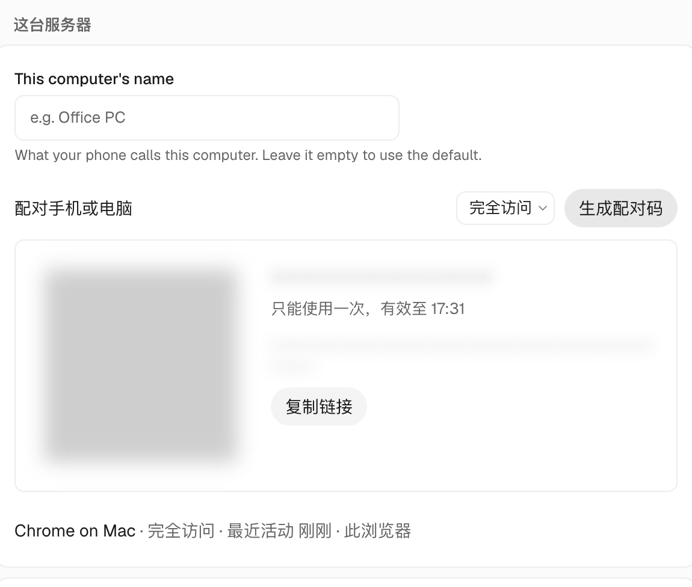

import { Steps } from '@astrojs/starlight/components';
import Figure from '../../../../components/Figure.astro';

大多数 Agent 工具都得坐在电脑前盯着。OpenMausBot 的活在服务器上干，**你在哪儿都能看。** 在地铁上打开手机，能看到 SEO Bot 刚推完日报、研究 Bot 正在查资料、另一个 Bot 在等你批准一条命令。点一下 **允许一次**，它就接着干。

## 手机上能做什么

| | 手机浏览器（用「完全访问」的配对码配对） | 原生 iOS App |
|---|---|---|
| 和任意 Bot 聊天、派新任务 | 能 | 能 |
| 处理审批卡片 | 能 | 能 |
| 查看进度和历史、按停止 | 能 | 能 |
| 新建 Bot、改模型、连接应用 | 能，和电脑上一样 | 不能，要在网页版里做 |
| App 关闭后收到提醒 | 不能 | 不能（只在打开时或刚切到后台时提醒） |

手机只是遥控器，关掉手机，Bot 照样在服务器上干活。

<Figure name="phone-approval" alt="水彩画：地铁上的人举着手机，屏幕上有两个按钮；窗外黄昏，一串小机器人沿虚线从手机一路走向远处山坡上亮着灯的小屋。" />

## 怎么连上

<Steps>

1. **服务器要有一个手机能访问到的地址。** 推荐用 Tailscale：不暴露到公网，个人使用免费。你的 AI Agent 可以帮你配好，见[如何从手机和笔记本连上服务器](/zh/guides/remote-access/)。

2. **手机装 Tailscale，登录同一个账号。**

3. **在电脑上生成手机的配对码。** 打开 **设置 → 电脑 → 这台服务器**，在配对那里选 **完全访问**（默认）或 **仅聊天和审批**，再点 **生成配对码**。服务器有公网地址（比如 Tailscale 地址）时会显示二维码和链接；没有的话只给一个代码，在手机上打开服务器地址的 `/pair` 页面输入。代码 10 分钟内有效，只能用一次。

   

4. **在手机上打开配对链接。** 想要接近 App 的体验，用 Safari（iPhone）或 Chrome（Android）打开后添加到主屏幕。网页版和 iOS App 关闭后都收不到提醒，需要时自己打开看。

</Steps>

:::caution[手机打开了页面，却一直卡在"正在连接"]
用流量时如果 Tailscale 打不通直连，就会改走中继。中继比直连慢，实时事件流可能跟不上。在服务器上运行 `tailscale status`，手机那一行写着 `relay "…"` 就是在走中继。原因和解决办法请参阅[远程访问](/zh/guides/remote-access/)。
:::

## 用得更顺手

- 想把关的 Bot 设成先问我。新 Bot 默认是 **直接执行**。哪个 Bot 的操作你想先过目，就在它的机器人设置里选 **先问我**，手机上批卡片很方便。跑例行任务的 Bot 保持直接执行，否则没人在时它会卡在审批卡片上。
- 定时任务有结果才汇报。手机上的消息越少越好，写法请参阅[追踪 X 热门讨论](/zh/recipes/x-trend-digest/)。

## 后续步骤

- [每天自动推送的 GSC 日报](/zh/recipes/gsc-daily-report/)：多账号、多个站点的数据，每天 9 点合成一份日报推到飞书群。
