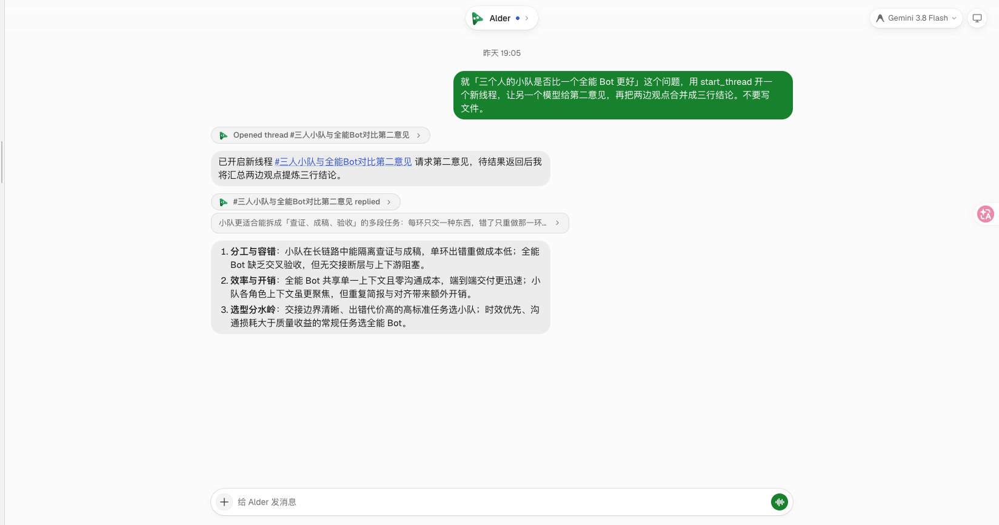

import { Steps } from '@astrojs/starlight/components';
import Figure from '../../../../components/Figure.astro';

想让另一个模型检查，通常意味着再建一个 Bot、再分一个目录、再写一套指令。其实一个 Bot 自己就能做：让它在另一个模型上新开一条线程（也就是挂在它名下的一段子对话），问完再把回答带回发起它的那段对话。

能这么做，是因为线程本身就是挂在同一个 Bot 下面的独立对话，可以单独选模型，单独跑完再把结果送回来。

<Figure name="second-opinion-riso" alt="孔版印刷风格：一只机器人坐在桌前看一张纸，左右各有一只小机器人靠过来，头顶飘着形状不同的对话气泡。" />

## 会发生什么

<Steps>

1. Bot 先列出模型和列表给出的状态；这个列表不会真的去试模型能不能回复。

2. 它在另一个模型（你点名的，或它自己挑的）上新开一条线程，并带上 `report_back`（答完自动把结果带回主对话），只问一个有边界的问题。侧栏显示对话时，线程会作为这个 Bot 下的一行出现。

3. 主对话里出现打开线程的状态（截图里是英文 `Opened thread #…`）。线程成功跑完、结果允许带回时，可能会出现一条已回复的状态，下面是它的回答预览，Bot 带着结果继续。

4. Bot 接着尝试合并两边的回答。线程保留自己的历史，之后还能打开读全文。

</Steps>



## 发给 Bot 的需求

发之前，先确认环境里至少有两个能正常回复的模型（见下面「需要你亲自做的」第 1 步）。确认后，在跟主 Bot 的一对一对话里发送。线程看不到这段主对话，所以要把判断需要的背景和限制一起写进问题。

```text title="发给 Bot 的需求"
就下面的问题，让另一个模型检查。

1. 用 list_models 挑一个可用、且不是你正在用的模型。
2. 在它上面开一个线程，带上 report_back，只问我问的这件事。
3. 它回复后，比较两边，给我三点：
   哪些一致、哪些不同、你会按哪一个做。

不要写文件。不要转给别的 Bot。

问题：三个人的小队是否比一个全能 Bot 更好？
```

如果指定模型，把上面第 1 条直接改成那个模型的名字就行。不点名的话，提示词会让它从 `list_models` 里挑。

## 需要你亲自做的

<Steps>

1. 先挑一个已经能用的第二个模型。给它发一个很短的任务试一下；跑不动就先修引擎，再指望它检查。

2. 定问题。一次只问一个边界清楚的问题，回答才扎实。把五个问题塞进同一条线程，多半只能拿回一团泛泛的总结。

3. 先想好两边意见不一致时怎么取舍。光多要一份回答用处不大，把分歧摊开比对才有用。

</Steps>

## 几个关键决定

| 决定 | 建议 | 原因 |
|---|---|---|
| 用哪个模型 | 有的话，换一个服务商 | 同门模型可能共享盲点 |
| 开几个线程 | 一个问题一个 | 每个线程有自己的对话和任务 |
| 让它带回什么 | 短回答加可合并的要点 | 长回答更难合并，细节也容易丢 |
| 谁来定 | 你 | 两个自信的回答也可能一起错 |

## 验证

1. 主对话里出现打开线程的状态；线程跑完且结果允许带回时，这条状态下面可能出现一条回复预览。
2. 线程不是挂在另一个 Bot 下面，并且保留自己的模型。
3. 最终回复里是合并后的结论，不是第二份回答的复制。

## 常见问题

**线程跑的还是同一个模型。** 在需求里点名；线程开出来后，打开它看模型选择。

**模型列出来了，但跑不动。** 可能是没登录、引擎起不来，也可能是这个模型对你的账户不可用。先去引擎设置逐项排查，再重试。

**侧栏里找不到线程。** 这种方式开的线程不会单独排在消息列表里，而是收在那个 Bot 名下。如果侧栏没显示对话，先在高级模式里打开 **设置 → 外观**，在 **对话** 里显示线程列表，再点 Bot 旁边的箭头展开线程列表。

**等半天什么都没回来。** 先去左侧栏展开这个 Bot 的线程列表，点开那条线程，看是不是卡在报错上。另外，本教程从跟 Bot 的一对一主对话发起；Bot 这样开出来的线程不能再开自己的线程，别在已有的线程里发。

## 改成适合你的

- 用在方案或代码评审：不用每处改动都跑双模型，只挑那些本来就容易起争执的地方，让另一个模型检查。
- 搭配便宜的第二模型：子线程跑在它自己选的模型上；如果小模型够用，可以用它做交叉检查。
- 三个视角：每个模型一个线程，再合并。一轮对话最多新开五个线程，而且都要从主对话开，不要在线程里套线程。

## 下一步

- [三个 Bot 接力](/zh/recipes/three-bot-team/)：什么时候该换成另一个 Bot 检查。
- [把重复的活变成 skill](/zh/guides/skills/)：把合并规则做成可复用的 skill。
- [如何登录引擎](/zh/guides/sign-in-engines/)：模型列出来但跑不动时怎么办。
