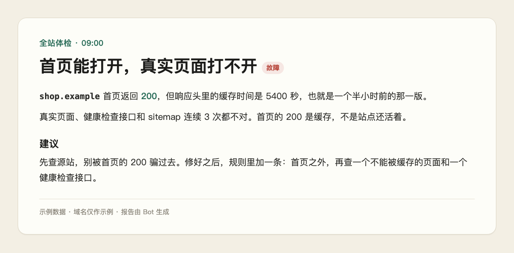

import { Steps } from '@astrojs/starlight/components';
import Figure from '../../../../components/Figure.astro';
import Diagram from '../../../../components/Diagram.astro';

每天一次，聊天里出现一句话：「全部正常」。有站点打不开、变慢或者证书快到期，收到的是一条写清原因和修法的报告。

<Figure name="site-check" alt="一家店面。机器人掀起橱窗，里面是黑的，地上有一个松脱的插头。橱窗上方浮着一份褪色的副本，机器人手里拿着三色清单。" />

下面是一张示例报告，用虚构数据展示格式：



## 200 不等于站点还活着

有一次，它发现一个站的首页能打开，但真实页面打不开。首页返回 200，看起来正常，其实返回的是缓存。真实页面、健康检查接口和 sitemap 都不对。

这也是为什么建议多加两条规则。首页之外，还要查一个不能被缓存的页面和一个健康检查接口。首页返回 200 时，再把缓存时间和缓存状态一起记下来。

## 两次差点误报

第一次跑体检，有个站超时了。它没有直接报故障，复查一次就正常了。从那以后，规则里写死了「两次都一样才报」。

另一个站的 sitemap 返回 404，但 robots.txt 里声明的地址是 sitemap-index.xml，那个能正常打开。它没有把这个算成故障。

还有一次，它提前列出了还没到 21 天报警线的证书。这份名单只是提前看一眼；到了报警线会按要处理的项报出来。走自动续期的站一般不用管，除非续期失败。

<Diagram name="site-check" alt="流程图：定时任务检查首页、不能缓存的页面、接口和 sitemap。没有异常就只回一句全部正常；有异常先复查一次，两次结果一样才报故障，不一样这一轮先不报。" />

## 交给 AI Agent

把下面这段发给一个 Bot，再把要查的地址发给它。它会先把检查跑一遍，报告不满意就改需求，定下来之后每天按点跑。

```text title="发给 Bot 的需求"
你是我的站点巡检员。每天检查一遍我给的地址，只把结果告诉我。

范围（我随后发给你）：
- 每个站的首页；
- 每个站一个不会被缓存的页面；
- 每个站一个健康检查接口；
- 每个站的 robots.txt 和里面声明的 sitemap。

每次检查这四件事：
1. 状态码和重定向链，最后落到哪个地址。
2. 从发请求到收完响应头用了多久。
3. 证书还有多少天到期，证书上的域名对不对。
4. 首页有没有命中缓存，缓存了多少秒。

判定：
- 超过 5 秒算慢，证书少于 21 天要处理，4xx 和 5xx 算故障。
- 任何一项不对，先复查一次；两次都一样才报。
- 首页正常但页面、接口或 sitemap 不正常，也按故障报，并说明可能是缓存。

报告：
- 全部正常时只回一句「全部正常」，不要列表，不要过程。
- 有问题时先说结论，再按根因分组。每条写清楚是什么、影响什么、最省事的修法。
- 同一个原因造成的多个站，合并成一条。
- 不要贴完整网页、命令输出或日志。

约束：
- 只读。不改配置、不重启服务、不提交工单、不联系任何人。
- 不在对话里打印密钥、token 或账号。
- 改配置前先备份。改 DNS、路由、时区之前先问我。
- 拿不准的时候停下来，告诉我要做什么。
- 缺工具就告诉我需要装什么，不要假装检查过。
```

## 需要你亲自做的

<Steps>

1. **列出要查的地址。** 每个站给四个：首页、一个你确认不会被缓存的页面（先看响应头）、一个健康检查接口、robots.txt。没有接口就写「没有」。

2. **定阈值。** 默认 5 秒、21 天。线路慢或者站点在海外，把 5 秒放宽到 8 秒，不用一上来就按最严的报。

3. **看着它跑第一次。** 结果不对就改需求，对了再让它排每天的时间。弹审批卡片的话，点 **允许一次**。

</Steps>

## 几个关键决定

| 决定 | 建议 | 原因 |
|---|---|---|
| 多久查一次 | **每天一次** | 按你能接受的发现延迟来定。一天一次是常见的起点 |
| 查什么 | 首页、不能缓存的页面、接口、sitemap | 只查首页会被缓存骗过去 |
| 报警阈值 | 5 秒、证书 21 天 | 阈值太紧会被网络抖动和正常续期吵到 |
| 出问题报什么 | 根因和修法 | 早上只有两分钟，报告要能直接照着做 |

## 常见问题

**首页能打开，真实页面打不开。** 首页命中了 CDN 缓存。查一个不能被缓存的页面和一个接口，把响应头里的缓存时间一起记下来。

**第一次超时，第二次正常。** 单次超时可能只是网络抖动。规则里写「两次都一样才报」。一样指的是同一个地址、同一项检查第二次仍然不对。换了地址或换了指标不算。

**sitemap 返回 404。** 先看 robots.txt 里声明的地址。声明的是 sitemap-index.xml 时，/sitemap.xml 404 不算故障。

**证书还有一个月就报警。** 把阈值改成 21 天。走自动续期的站不用管，除非续期失败。

**同一类故障收到好几条。** 让报告按根因分组，同一个原因造成的多个站，合并成一条。

## 验证

在对话里让它现在检查一遍。正常时应该只收到「全部正常」。想确认它真的会报，给它一个你自己的、确定会 404 的地址，看它有没有按故障格式报出来。

想留记录，就让定时任务自己跑一次；**运行记录**里是定时运行的结果。

## 改成适合你的

- **换一个推送渠道：** 只改发送那一步。

## 后续步骤

- [如何让 Bot 每天定时自己干活](/zh/guides/routines/)：时区、cron、电脑睡着和失败恢复。
- [每天早上两分钟看完 GitHub](/zh/recipes/github-morning-triage/)：另一件适合交给值班 Bot 的事。
